# CSSBattle solutions

Exported from CSSBattle account `razvanm`.

Each target folder contains the extracted `solution.html`, the official `reference.png`, a Chrome-rendered `rendered.png`, `metadata.json`, and a README with the reference image plus the full solution.

## Scoring note

`Score then` is the score displayed on the saved submission page. `Score now` was collected on 2026-08-23 by loading each exported solution into CSSBattle and clicking Submit. When CSSBattle returned the fresh result under `Last score` instead of `Your stats`, it was accepted only when the returned character count matched the exported solution.

## Summary

- Targets exported: 129
- Battles covered: 25
- Total score then: 87508.97
- Total score now: 61724.87
- Current scores collected: 2026-08-23T01:04:14.062Z

## Battles

| Battle | Name | Targets | Score then | Score now | Folder |
|---:|---|---:|---:|---:|---|
| 1 | Pilot Battle | 12 | 8613.53 | 7880.53 | [battle-01-pilot-battle](./battle-01-pilot-battle/) |
| 2 | Visibility | 6 | 4311.12 | 4136.56 | [battle-02-visibility](./battle-02-visibility/) |
| 3 | Cursor | 2 | 1369.30 | 1369.30 | [battle-03-cursor](./battle-03-cursor/) |
| 4 | Display | 8 | 5526.75 | 3336.32 | [battle-04-display](./battle-04-display/) |
| 5 | Inline | 2 | 1479.65 | 1479.65 | [battle-05-inline](./battle-05-inline/) |
| 6 | Conic | 2 | 1442.11 | 1075.96 | [battle-06-conic](./battle-06-conic/) |
| 7 | Backface | 9 | 6292.10 | 3646.05 | [battle-07-backface](./battle-07-backface/) |
| 8 | Transition | 3 | 2064.45 | 1603.56 | [battle-08-transition](./battle-08-transition/) |
| 9 | Margin | 2 | 1378.82 | 1156.24 | [battle-09-margin](./battle-09-margin/) |
| 10 | Block | 6 | 3845.85 | 1179.98 | [battle-10-block](./battle-10-block/) |
| 11 | Overflow | 8 | 5315.26 | 2434.70 | [battle-11-overflow](./battle-11-overflow/) |
| 12 | Blend | 8 | 5377.13 | 3301.57 | [battle-12-blend](./battle-12-blend/) |
| 13 | Clip | 8 | 4962.29 | 2734.31 | [battle-13-clip](./battle-13-clip/) |
| 14 | ZIndex | 4 | 2516.79 | 955.25 | [battle-14-zindex](./battle-14-zindex/) |
| 15 | Filter | 8 | 5523.21 | 3108.23 | [battle-15-filter](./battle-15-filter/) |
| 16 | Aspect | 8 | 5558.54 | 1955.80 | [battle-16-aspect](./battle-16-aspect/) |
| 17 | Christmas 🎄 | 4 | 2597.42 | 2294.05 | [battle-17-christmas](./battle-17-christmas/) |
| 18 | Float | 8 | 5051.84 | 3794.00 | [battle-18-float](./battle-18-float/) |
| 19 | Spacing | 8 | 5779.16 | 5779.16 | [battle-19-spacing](./battle-19-spacing/) |
| 20 | Hover | 8 | 4931.44 | 4931.44 | [battle-20-hover](./battle-20-hover/) |
| 21 | Rotate | 1 | 728.67 | 728.67 | [battle-21-rotate](./battle-21-rotate/) |
| 22 | Grid | 1 | 783.08 | 783.08 | [battle-22-grid](./battle-22-grid/) |
| 24 | Offset | 1 | 754.22 | 754.22 | [battle-24-offset](./battle-24-offset/) |
| 26 | Initial | 1 | 703.34 | 703.34 | [battle-26-initial](./battle-26-initial/) |
| 30 | Gradient | 1 | 602.90 | 602.90 | [battle-30-gradient](./battle-30-gradient/) |

## Targets

| Target | Reference | Name | Battle | Score then | Score now | Chars | Current chars | Match | Folder |
|---:|---|---|---:|---:|---:|---:|---:|---:|---|
| 1 |  | Simply Square | 1 | 839.08 | 839.08 | 54 | 54 | 100% | [files](./battle-01-pilot-battle/target-001-simply-square/) |
| 2 |  | Carrom | 1 | 788.39 | 788.39 | 79 | 79 | 100% | [files](./battle-01-pilot-battle/target-002-carrom/) |
| 3 |  | Push Button | 1 | 738.87 | 738.87 | 111 | 111 | 100% | [files](./battle-01-pilot-battle/target-003-push-button/) |
| 4 |  | Ups n Downs | 1 | 712.60 | 712.60 | 133 | 133 | 100% | [files](./battle-01-pilot-battle/target-004-ups-n-downs/) |
| 5 |  | Acid Rain | 1 | 683.80 | 683.80 | 164 | 164 | 100% | [files](./battle-01-pilot-battle/target-005-acid-rain/) |
| 6 |  | Missing Slice | 1 | 723.86 | 723.86 | 123 | 123 | 100% | [files](./battle-01-pilot-battle/target-006-missing-slice/) |
| 7 |  | Leafy Trail | 1 | 733.67 | 733.67 | 115 | 115 | 100% | [files](./battle-01-pilot-battle/target-007-leafy-trail/) |
| 8 |  | Forking Crazy | 1 | 669.92 | 575.82 | 183 | 183 | 100% | [files](./battle-01-pilot-battle/target-008-forking-crazy/) |
| 9 |  | Tesseract | 1 | 699.48 | 699.48 | 146 | 146 | 100% | [files](./battle-01-pilot-battle/target-009-tesseract/) |
| 10 |  | Cloaked Spirits | 1 | 642.59 | 3.69 | 235 | 235 | 100% | [files](./battle-01-pilot-battle/target-010-cloaked-spirits/) |
| 11 |  | Eye of Sauron | 1 | 696.67 | 696.67 | 149 | 149 | 100% | [files](./battle-01-pilot-battle/target-011-eye-of-sauron/) |
| 12 |  | Wiggly Moustache | 1 | 684.60 | 684.60 | 163 | 163 | 100% | [files](./battle-01-pilot-battle/target-012-wiggly-moustache/) |
| 13 |  | Totally Triangle | 2 | 830.13 | 830.13 | 58 | 58 | 100% | [files](./battle-02-visibility/target-013-totally-triangle/) |
| 14 |  | Web Maker Logo | 2 | 700.43 | 525.87 | 145 | 145 | 100% | [files](./battle-02-visibility/target-014-web-maker-logo/) |
| 15 | 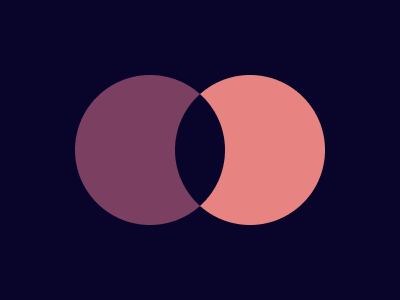 | Overlap | 2 | 741.54 | 741.54 | 109 | 109 | 100% | [files](./battle-02-visibility/target-015-overlap/) |
| 16 |  | Eye of the Tiger | 2 | 687.05 | 687.05 | 160 | 160 | 100% | [files](./battle-02-visibility/target-016-eye-of-the-tiger/) |
| 17 |  | Fidget Spinner | 2 | 649.61 | 649.61 | 219 | 219 | 100% | [files](./battle-02-visibility/target-017-fidget-spinner/) |
| 18 |  | Matrix | 2 | 702.36 | 702.36 | 143 | 143 | 100% | [files](./battle-02-visibility/target-018-matrix/) |
| 19 |  | Cube | 3 | 696.67 | 696.67 | 149 | 149 | 100% | [files](./battle-03-cursor/target-019-cube/) |
| 20 |  | Ticket | 3 | 672.63 | 672.63 | 179 | 179 | 100% | [files](./battle-03-cursor/target-020-ticket/) |
| 21 |  | SitePoint Logo | 4 | 662.36 | 662.36 | 195 | 195 | 100% | [files](./battle-04-display/target-021-sitepoint-logo/) |
| 22 |  | Cloud | 4 | 710.47 | 710.47 | 135 | 135 | 100% | [files](./battle-04-display/target-022-cloud/) |
| 23 |  | Boxception | 4 | 751.31 | 751.31 | 102 | 102 | 100% | [files](./battle-04-display/target-023-boxception/) |
| 24 |  | Switches | 4 | 674.74 | 34.41 | 176 | 176 | 100% | [files](./battle-04-display/target-024-switches/) |
| 25 |  | Blossom | 4 | 646.85 | 1.44 | 225 | 225 | 100% | [files](./battle-04-display/target-025-blossom/) |
| 26 |  | Smiley | 4 | 712.60 | 2.21 | 133 | 133 | 100% | [files](./battle-04-display/target-026-smiley/) |
| 27 |  | Lock Up | 4 | 708.39 | 708.39 | 137 | 137 | 100% | [files](./battle-04-display/target-027-lock-up/) |
| 28 |  | Cups & Balls | 4 | 660.03 | 465.73 | 199 | 199 | 100% | [files](./battle-04-display/target-028-cups-balls/) |
| 29 |  | Suffocate | 5 | 708.39 | 708.39 | 137 | 137 | 100% | [files](./battle-05-inline/target-029-suffocate/) |
| 30 |  | Horizon | 5 | 771.26 | 771.26 | 89 | 89 | 100% | [files](./battle-05-inline/target-030-horizon/) |
| 31 | 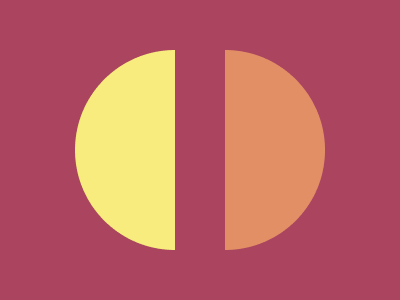 | Equals | 6 | 754.22 | 754.22 | 100 | 100 | 100% | [files](./battle-06-conic/target-031-equals/) |
| 32 |  | Band-aid | 6 | 687.89 | 321.74 | 159 | 159 | 100% | [files](./battle-06-conic/target-032-band-aid/) |
| 33 |  | Birdie | 7 | 670.59 | 1.20 | 182 | 182 | 100% | [files](./battle-07-backface/target-033-birdie/) |
| 34 |  | Christmas Tree | 7 | 729.91 | 597.96 | 118 | 118 | 100% | [files](./battle-07-backface/target-034-christmas-tree/) |
| 35 |  | Ice Cream | 7 | 658.33 | 1.20 | 202 | 202 | 100% | [files](./battle-07-backface/target-035-ice-cream/) |
| 36 |  | Interleaved | 7 | 700.43 | 700.43 | 145 | 145 | 100% | [files](./battle-07-backface/target-036-interleaved/) |
| 37 |  | Tunnel | 7 | 705.33 | 325.78 | 140 | 140 | 100% | [files](./battle-07-backface/target-037-tunnel/) |
| 38 |  | Not Simply Square | 7 | 731.15 | 731.15 | 117 | 117 | 100% | [files](./battle-07-backface/target-038-not-simply-square/) |
| 39 |  | Sunset | 7 | 688.73 | 688.73 | 158 | 158 | 100% | [files](./battle-07-backface/target-039-sunset/) |
| 40 |  | Letter B | 7 | 713.68 | 1.71 | 132 | 132 | 100% | [files](./battle-07-backface/target-040-letter-b/) |
| 41 |  | Fox Head | 7 | 693.95 | 597.89 | 152 | 152 | 100% | [files](./battle-07-backface/target-041-fox-head/) |
| 42 |  | Baby | 8 | 640.61 | 179.72 | 240 | 240 | 100% | [files](./battle-08-transition/target-042-baby/) |
| 43 |  | Wrench | 8 | 697.60 | 697.60 | 148 | 148 | 100% | [files](./battle-08-transition/target-043-wrench/) |
| 44 |  | Stripes | 8 | 726.24 | 726.24 | 121 | 121 | 100% | [files](./battle-08-transition/target-044-stripes/) |
| 45 | 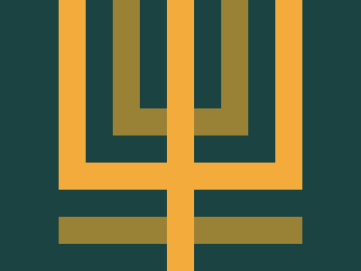 | Magical Tree | 9 | 678.39 | 678.39 | 171 | 171 | 100% | [files](./battle-09-margin/target-045-magical-tree/) |
| 46 |  | Mountains | 9 | 700.43 | 477.85 | 145 | 145 | 100% | [files](./battle-09-margin/target-046-mountains/) |
| 47 |  | Corona Virus | 10 | 629.93 | 17.91 | 272 | 272 | 100% | [files](./battle-10-block/target-047-corona-virus/) |
| 48 |  | Wash Your Hands | 10 | 698.53 | 9.20 | 147 | 147 | 100% | [files](./battle-10-block/target-048-wash-your-hands/) |
| 49 |  | Stay at Home | 10 | 636.57 | 0.94 | 251 | 251 | 100% | [files](./battle-10-block/target-049-stay-at-home/) |
| 50 |  | Use Hand Sanitizer | 10 | 610.20 | 483.37 | 385 | 385 | 100% | [files](./battle-10-block/target-050-use-hand-sanitizer/) |
| 51 |  | Wear a Mask | 10 | 627.21 | 25.15 | 282 | 282 | 100% | [files](./battle-10-block/target-051-wear-a-mask/) |
| 52 |  | Break the Chain | 10 | 643.41 | 643.41 | 233 | 233 | 100% | [files](./battle-10-block/target-052-break-the-chain/) |
| 53 |  | Pastel Logo | 11 | 713.68 | 1.47 | 132 | 132 | 100% | [files](./battle-11-overflow/target-053-pastel-logo/) |
| 54 |  | Black Lives Matter | 11 | 611.99 | 375.35 | 368 | 368 | 100% | [files](./battle-11-overflow/target-054-black-lives-matter/) |
| 55 |  | Windmill | 11 | 690.43 | 2.21 | 156 | 156 | 100% | [files](./battle-11-overflow/target-055-windmill/) |
| 56 |  | Skull | 11 | 619.13 | 561.54 | 319 | 319 | 100% | [files](./battle-11-overflow/target-056-skull/) |
| 57 |  | Pillars | 11 | 646.85 | 447.67 | 225 | 225 | 100% | [files](./battle-11-overflow/target-057-pillars/) |
| 58 |  | Rose | 11 | 622.92 | 445.52 | 300 | 300 | 100% | [files](./battle-11-overflow/target-058-rose/) |
| 59 |  | Earth | 11 | 654.57 | 2.94 | 209 | 209 | 100% | [files](./battle-11-overflow/target-059-earth/) |
| 60 |  | Evil Triangles | 11 | 755.69 | 598.00 | 99 | 99 | 100% | [files](./battle-11-overflow/target-060-evil-triangles/) |
| 61 |  | ImprovMX | 12 | 600.87 | 522.88 | 643 | 643 | 100% | [files](./battle-12-blend/target-061-improvmx/) |
| 62 |  | Sunset | 12 | 684.60 | 684.60 | 163 | 163 | 100% | [files](./battle-12-blend/target-062-sunset/) |
| 63 | 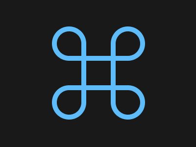 | Command Key | 12 | 678.39 | 678.39 | 171 | 171 | 100% | [files](./battle-12-blend/target-063-command-key/) |
| 64 |  | Door Knob | 12 | 688.73 | 2.21 | 158 | 158 | 100% | [files](./battle-12-blend/target-064-door-knob/) |
| 65 |  | Max Volume | 12 | 624.98 | 40.38 | 291 | 291 | 100% | [files](./battle-12-blend/target-065-max-volume/) |
| 66 | 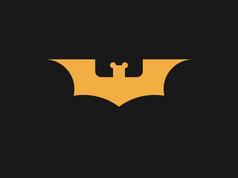 | Batmicky | 12 | 683.00 | 683.00 | 165 | 165 | 100% | [files](./battle-12-blend/target-066-batmicky/) |
| 67 |  | Video Reel | 12 | 728.67 | 2.22 | 119 | 119 | 100% | [files](./battle-12-blend/target-067-video-reel/) |
| 68 |  | Bell | 12 | 687.89 | 687.89 | 159 | 159 | 100% | [files](./battle-12-blend/target-068-bell/) |
| 69 |  | PushOwl | 13 | 656.15 | 656.15 | 206 | 206 | 100% | [files](./battle-13-clip/target-069-pushowl/) |
| 70 |  | Froggy | 13 | 627.21 | 2.43 | 282 | 282 | 100% | [files](./battle-13-clip/target-070-froggy/) |
| 71 |  | Elephant | 13 | 615.07 | 615.07 | 344 | 344 | 100% | [files](./battle-13-clip/target-071-elephant/) |
| 72 |  | Sheep | 13 | 614.65 | 194.42 | 347 | 347 | 100% | [files](./battle-13-clip/target-072-sheep/) |
| 73 |  | Happy Tiger | 13 | 618.94 | 618.94 | 320 | 320 | 100% | [files](./battle-13-clip/target-073-happy-tiger/) |
| 74 | 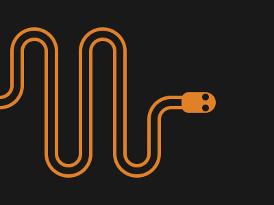 | Danger Noodle | 13 | 600.51 | 25.79 | 699 | 699 | 100% | [files](./battle-13-clip/target-074-danger-noodle/) |
| 75 | 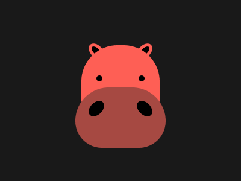 | Hippo | 13 | 600.11 | 600.11 | 861 | 861 | 100% | [files](./battle-13-clip/target-075-hippo/) |
| 76 | 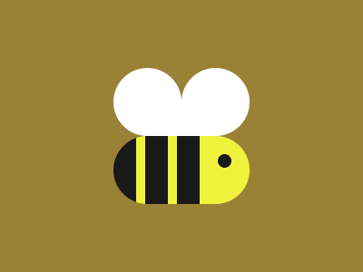 | Beeee | 13 | 629.65 | 21.40 | 273 | 273 | 100% | [files](./battle-13-clip/target-076-beeee/) |
| 77 |  | Notes | 14 | 654.57 | 654.57 | 209 | 209 | 100% | [files](./battle-14-zindex/target-077-notes/) |
| 78 |  | Ukulele | 14 | 614.93 | 279.35 | 345 | 345 | 100% | [files](./battle-14-zindex/target-078-ukulele/) |
| 79 |  | Tambourine | 14 | 620.84 | 3.67 | 310 | 310 | 100% | [files](./battle-14-zindex/target-079-tambourine/) |
| 80 | 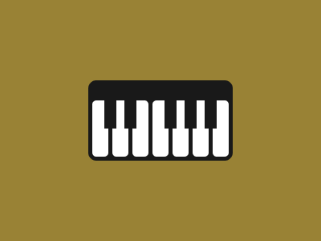 | Piano | 14 | 626.45 | 17.66 | 285 | 285 | 100% | [files](./battle-14-zindex/target-080-piano/) |
| 81 |  | Odoo | 15 | 656.69 | 351.67 | 205 | 205 | 100% | [files](./battle-15-filter/target-081-odoo/) |
| 82 |  | Diamond Cut | 15 | 694.85 | 597.90 | 151 | 151 | 100% | [files](./battle-15-filter/target-082-diamond-cut/) |
| 83 |  | Supernova | 15 | 694.85 | 2.46 | 151 | 151 | 100% | [files](./battle-15-filter/target-083-supernova/) |
| 84 | 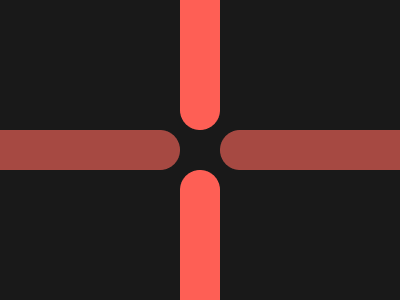 | Junction | 15 | 742.90 | 742.90 | 108 | 108 | 100% | [files](./battle-15-filter/target-084-junction/) |
| 85 |  | Pythagoras | 15 | 694.85 | 22.43 | 151 | 151 | 100% | [files](./battle-15-filter/target-085-pythagoras/) |
| 86 |  | Stairway | 15 | 684.60 | 684.60 | 163 | 163 | 100% | [files](./battle-15-filter/target-086-stairway/) |
| 87 |  | Building Blocks | 15 | 649.14 | 0.94 | 220 | 220 | 100% | [files](./battle-15-filter/target-087-building-blocks/) |
| 88 |  | Tight Corner | 15 | 705.33 | 705.33 | 140 | 140 | 100% | [files](./battle-15-filter/target-088-tight-corner/) |
| 89 |  | Summit | 16 | 712.60 | 2.21 | 133 | 133 | 100% | [files](./battle-16-aspect/target-089-summit/) |
| 90 |  | Eclipse | 16 | 700.43 | 597.91 | 145 | 145 | 100% | [files](./battle-16-aspect/target-090-eclipse/) |
| 91 |  | Reflection | 16 | 721.52 | 721.52 | 125 | 125 | 100% | [files](./battle-16-aspect/target-091-reflection/) |
| 92 |  | Squeeze | 16 | 726.24 | 2.72 | 121 | 121 | 100% | [files](./battle-16-aspect/target-092-squeeze/) |
| 93 | 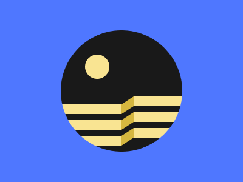 | Great Wall | 16 | 621.65 | 2.17 | 306 | 306 | 100% | [files](./battle-16-aspect/target-093-great-wall/) |
| 94 |  | Ripples | 16 | 688.73 | 597.88 | 158 | 158 | 100% | [files](./battle-16-aspect/target-094-ripples/) |
| 95 | 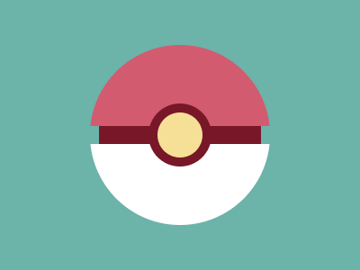 | Pokeball | 16 | 687.89 | 27.68 | 159 | 159 | 100% | [files](./battle-16-aspect/target-095-pokeball/) |
| 96 |  | Mandala | 16 | 699.48 | 3.71 | 146 | 146 | 100% | [files](./battle-16-aspect/target-096-mandala/) |
| 97 |  | Snowman | 17 | 620.64 | 620.64 | 311 | 311 | 100% | [files](./battle-17-christmas/target-097-snowman/) |
| 98 |  | Candle | 17 | 660.03 | 437.72 | 199 | 199 | 100% | [files](./battle-17-christmas/target-098-candle/) |
| 99 |  | Gift Box | 17 | 676.91 | 595.85 | 173 | 173 | 100% | [files](./battle-17-christmas/target-099-gift-box/) |
| 100 |  | CSSBattle | 17 | 639.84 | 639.84 | 242 | 242 | 100% | [files](./battle-17-christmas/target-100-cssbattle/) |
| 101 | 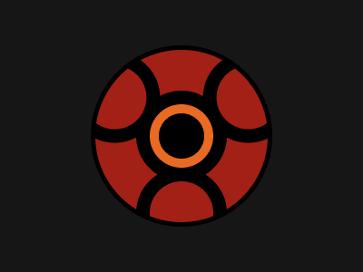 | Sharingan | 18 | 662.36 | 5.19 | 195 | 195 | 100% | [files](./battle-18-float/target-101-sharingan/) |
| 102 |  | One Piece | 18 | 606.09 | 606.09 | 439 | 439 | 100% | [files](./battle-18-float/target-102-one-piece/) |
| 103 |  | Super Saiyan | 18 | 610.00 | 610.00 | 387 | 387 | 100% | [files](./battle-18-float/target-103-super-saiyan/) |
| 104 |  | Amegakure | 18 | 613.31 | 613.31 | 357 | 357 | 100% | [files](./battle-18-float/target-104-amegakure/) |
| 105 | 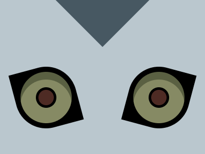 | Ryuk | 18 | 620.84 | 620.84 | 310 | 310 | 100% | [files](./battle-18-float/target-105-ryuk/) |
| 106 | 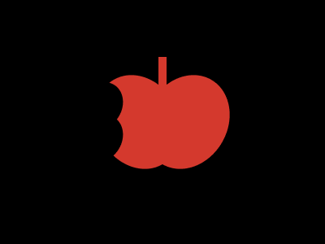 | Ryuk's Apple | 18 | 713.68 | 713.68 | 132 | 132 | 100% | [files](./battle-18-float/target-106-ryuk-s-apple/) |
| 107 |  | Sealing Wand | 18 | 611.99 | 611.99 | 368 | 368 | 100% | [files](./battle-18-float/target-107-sealing-wand/) |
| 108 |  | Clow Card | 18 | 613.57 | 12.90 | 355 | 355 | 100% | [files](./battle-18-float/target-108-clow-card/) |
| 109 | 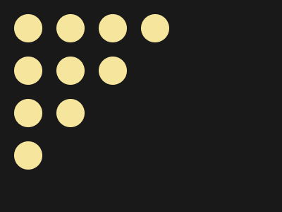 | Curtain | 19 | 771.26 | 771.26 | 89 | 89 | 100% | [files](./battle-19-spacing/target-109-curtain/) |
| 110 |  | Sunrays | 19 | 687.89 | 687.89 | 159 | 159 | 100% | [files](./battle-19-spacing/target-110-sunrays/) |
| 111 |  | Rain Drops | 19 | 734.95 | 734.95 | 114 | 114 | 100% | [files](./battle-19-spacing/target-111-rain-drops/) |
| 112 |  | Chevron | 19 | 687.05 | 687.05 | 160 | 160 | 100% | [files](./battle-19-spacing/target-112-chevron/) |
| 113 |  | Black Light | 19 | 790.19 | 790.19 | 78 | 78 | 100% | [files](./battle-19-spacing/target-113-black-light/) |
| 114 |  | Negative Box | 19 | 747.04 | 747.04 | 105 | 105 | 100% | [files](./battle-19-spacing/target-114-negative-box/) |
| 115 |  | Droplet | 19 | 684.60 | 684.60 | 163 | 163 | 100% | [files](./battle-19-spacing/target-115-droplet/) |
| 116 |  | Headphones | 19 | 676.18 | 676.18 | 174 | 174 | 100% | [files](./battle-19-spacing/target-116-headphones/) |
| 117 |  | Arineo | 20 | 600.97 | 600.97 | 632 | 632 | 100% | [files](./battle-20-hover/target-117-arineo/) |
| 118 |  | Donkey Kong | 20 | 625.22 | 625.22 | 290 | 290 | 100% | [files](./battle-20-hover/target-118-donkey-kong/) |
| 119 | 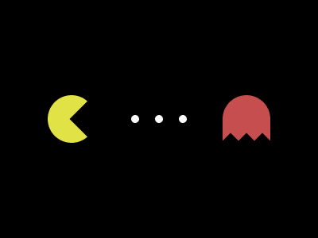 | Pacman | 20 | 602.04 | 602.04 | 554 | 554 | 100% | [files](./battle-20-hover/target-119-pacman/) |
| 120 | 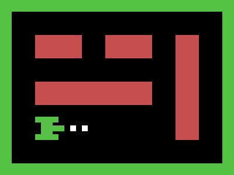 | Tank | 20 | 648.67 | 648.67 | 221 | 221 | 100% | [files](./battle-20-hover/target-120-tank/) |
| 121 |  | Duck Hunt | 20 | 617.22 | 617.22 | 330 | 330 | 100% | [files](./battle-20-hover/target-121-duck-hunt/) |
| 122 | 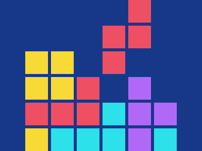 | Tetris | 20 | 606.27 | 606.27 | 436 | 436 | 100% | [files](./battle-20-hover/target-122-tetris/) |
| 123 | 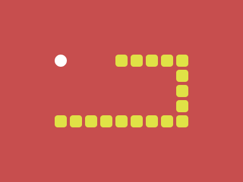 | Snake | 20 | 627.74 | 627.74 | 280 | 280 | 100% | [files](./battle-20-hover/target-123-snake/) |
| 124 | 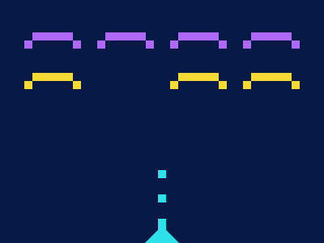 | Space Invaders | 20 | 603.31 | 603.31 | 503 | 503 | 100% | [files](./battle-20-hover/target-124-space-invaders/) |
| 130 |  | Letter O | 21 | 728.67 | 728.67 | 119 | 119 | 100% | [files](./battle-21-rotate/target-130-letter-o/) |
| 137 |  | Elbow | 22 | 783.08 | 783.08 | 82 | 82 | 100% | [files](./battle-22-grid/target-137-elbow/) |
| 148 |  | Eight | 24 | 754.22 | 754.22 | 100 | 100 | 100% | [files](./battle-24-offset/target-148-eight/) |
| 160 |  | Donut | 26 | 703.34 | 703.34 | 142 | 142 | 100% | [files](./battle-26-initial/target-160-donut/) |
| 187 |  | Striped Triangle | 30 | 602.90 | 602.90 | 517 | 517 | 100% | [files](./battle-30-gradient/target-187-striped-triangle/) |

## Solutions

<details id="target-001">
<summary>Target #1 - Simply Square</summary>


Score then: 839.08 | Score now: 839.08 | Characters: 54

```html
<a style=box-shadow:0+0+0+2in#b5e0ba,0+0+0+5in#5d3a3a>
```

[Target files](./battle-01-pilot-battle/target-001-simply-square/)

</details>

<details id="target-002">
<summary>Target #2 - Carrom</summary>


Score then: 788.39 | Score now: 788.39 | Characters: 79

```html
<style>*{background:69%44q/65%53%conic-gradient(at 80%53q,#fdc57b 25%,#62374e 0
```

[Target files](./battle-01-pilot-battle/target-002-carrom/)

</details>

<details id="target-003">
<summary>Target #3 - Push Button</summary>


Score then: 738.87 | Score now: 738.87 | Characters: 111

```html
<style>*{margin:75 50;background:radial-gradient(1q,#EEB850 26q,0,#243D83 79q,0,#0000 132q,#243D83)space#6592CF
```

[Target files](./battle-01-pilot-battle/target-003-push-button/)

</details>

<details id="target-004">
<summary>Target #4 - Ups n Downs</summary>


Score then: 712.60 | Score now: 712.60 | Characters: 133

```html
<style>*{background:#62306D}*>*{background:#F7EC7D;clip-pat\68:path('M42 142v42a1,1,0,00100,15V92a1,1,0,01100,0v92a1,1,0,00100,15v-57
```

[Target files](./battle-01-pilot-battle/target-004-ups-n-downs/)

</details>

<details id="target-005">
<summary>Target #5 - Acid Rain</summary>


Score then: 683.80 | Score now: 683.80 | Characters: 164

```html
<style>*{background:radial-gradient(1q,#f3ac3c,63q,#0b2429)63q -127q}*>*{border-radius:50%0+50%50%;box-shadow:63q -63q#998235;margin:150+50%30+80;background:#F3AC3C
```

[Target files](./battle-01-pilot-battle/target-005-acid-rain/)

</details>

<details id="target-006">
<summary>Target #6 - Missing Slice</summary>


Score then: 723.86 | Score now: 723.86 | Characters: 123

```html
<style>*{background:radial-gradient(1q,#0000,25vw,#E3516E),conic-gradient(#FADE8B,25%,#E3516E 0 50%,#F7F3D7 0 75%,#51B5A9 0
```

[Target files](./battle-01-pilot-battle/target-006-missing-slice/)

</details>

<details id="target-007">
<summary>Target #7 - Leafy Trail</summary>


Score then: 733.67 | Score now: 733.67 | Characters: 115

```html
<body bgcolor=0B2429 style=border-radius:67%0;margin:75+85%75-90;box-shadow:7cm+0#F3AC3C,57mm+0#998235,55vh+0#4984>
```

[Target files](./battle-01-pilot-battle/target-007-leafy-trail/)

</details>

<details id="target-008">
<summary>Target #8 - Forking Crazy</summary>


Score then: 669.92 | Score now: 575.82 | Characters: 183

```html
<body bgcolor=6592CF style=margin:50+190+140;border-radius:1in;box-shadow:5vw+0,-5vw+0,10vw+0#6592CF,-10vw+0#6592CF,15vw+0,-15vw+0,0-201q+0+25vw#6592CF,0+32q+0+60px,0+2in text=060F55>
```

[Target files](./battle-01-pilot-battle/target-008-forking-crazy/)

</details>

<details id="target-009">
<summary>Target #9 - Tesseract</summary>


Score then: 699.48 | Score now: 699.48 | Characters: 146

```html
<style>*{border:53q solid#222730;background:radial-gradient(#393E46 24%,#4CAAB3 0)}html{border-width:75 0}*>*{margin:-50 75;transform:rotate(45deg
```

[Target files](./battle-01-pilot-battle/target-009-tesseract/)

</details>

<details id="target-010">
<summary>Target #10 - Cloaked Spirits</summary>


Score then: 642.59 | Score now: 3.69 | Characters: 235

```html
<style>*>*{--:linear-gradient(#F7EC7D,#F7EC7D)no-repeat 50%;background:radial-gradient(1q,#E38F66 32q,#AA445F 0 50px,#0000 0)0 53q/50%,radial-gradient(1q,#AA445F 32q,#E38F66 0 53q,#0000 0)0-53q,var(--)50vw/75%68%,var(--)25vw/25%#62306D
```

[Target files](./battle-01-pilot-battle/target-010-cloaked-spirits/)

</details>

<details id="target-011">
<summary>Target #11 - Eye of Sauron</summary>


Score then: 696.67 | Score now: 696.67 | Characters: 149

```html
ᐡ<p>ᐢ<style>p{margin:-380 200}*>*{background:radial-gradient(1q,#84271C,26q,#191210 0 53q,#eca03d 0 74q,#191210);margin:98 36;color:ECA03D;font:300q'
```

[Target files](./battle-01-pilot-battle/target-011-eye-of-sauron/)

</details>

<details id="target-012">
<summary>Target #12 - Wiggly Moustache</summary>


Score then: 684.60 | Score now: 684.60 | Characters: 163

```html
ᐢ<p>ᐡ<p i>.<style>html{background:#F5D6B4;color:D86F45;font:300q a}*+*{-webkit-box-reflect:right -32vw;margin:48 136}p{margin:-280-80}[i]{margin:-417-76;font:40vw'
```

[Target files](./battle-01-pilot-battle/target-012-wiggly-moustache/)

</details>

<details id="target-013">
<summary>Target #13 - Totally Triangle</summary>


Score then: 830.13 | Score now: 830.13 | Characters: 58

```html
<body bgcolor=0B2429 style=zoom:59;margin:-8 text=F3AC3C>◤
```

[Target files](./battle-02-visibility/target-013-totally-triangle/)

</details>

<details id="target-014">
<summary>Target #14 - Web Maker Logo</summary>


Score then: 700.43 | Score now: 525.87 | Characters: 145

```html
▾<p>▴<style>p{margin:-426 110;color:FD4602;--:#FF6D00}*{background:#F2F2B6;color:FF6D00;margin:-7.2%6;text-shadow:var(--,#FD4602)5vw 0;font:388q'
```

[Target files](./battle-02-visibility/target-014-web-maker-logo/)

</details>

<details id="target-015">
<summary>Target #15 - Overlap</summary>


Score then: 741.54 | Score now: 741.54 | Characters: 109

```html
<body bgcolor=09042A style=margin:75+44%75+75;border-radius:50%;box-shadow:25vw+0#E78481,inset+25vw+0#7B3F61>
```

[Target files](./battle-02-visibility/target-015-overlap/)

</details>

<details id="target-016">
<summary>Target #16 - Eye of the Tiger</summary>


Score then: 687.05 | Score now: 687.05 | Characters: 160

```html
<style>*{margin:7%50;background:#0b2429}*>*{background:radial-gradient(1q,#0000 26q,#f3ac3c 0 74q,#0000 0 95q,#998235);border-radius:50%0;transform:rotate(45deg
```

[Target files](./battle-02-visibility/target-016-eye-of-the-tiger/)

</details>

<details id="target-017">
<summary>Target #17 - Fidget Spinner</summary>


Score then: 649.61 | Score now: 649.61 | Characters: 219

```html
<style>*>*{margin:120 230 120 110;border-radius:50%;color:09042A;box-shadow:63q 56q#F5BB9C,63q -56q#F5BB9C,63q 56q 0 11q,63q -56q 0 11q,inset 0 2in,30vw 0,0 0 0 11q#E78481,30vw 0 0 11q#E78481,63q 0 0 9q#E78481,0 0 0 9in
```

[Target files](./battle-02-visibility/target-017-fidget-spinner/)

</details>

<details id="target-018">
<summary>Target #18 - Matrix</summary>


Score then: 702.36 | Score now: 702.36 | Characters: 143

```html
<style>*>*{background:radial-gradient(at 99%99%,#0000,84q,#5C434C 0)30%45%/25%106q,0 0/50%67%repeating-conic-gradient(#F5D6B4,25%,#F09462 0 50%
```

[Target files](./battle-02-visibility/target-018-matrix/)

</details>

<details id="target-019">
<summary>Target #19 - Cube</summary>


Score then: 696.67 | Score now: 696.67 | Characters: 149

```html
<body bgcolor=0B2429 style=margin:-97+59+45;border:solid+47vh;border-color:0#4984#F3AC3C#998235;clip-pat\68:path('m141,141,71,70v71l-71,71-70-70v-72>
```

[Target files](./battle-03-cursor/target-019-cube/)

</details>

<details id="target-020">
<summary>Target #20 - Ticket</summary>


Score then: 672.63 | Score now: 672.63 | Characters: 179

```html
<style>*{margin:100;border-image:radial-gradient(#62306D 71%,#0000 0)100%fill/43q/5vw}*+*{zoom:.5;margin:0 30%0 0;background:conic-gradient(at 70%99in,#E38F66,#F7EC7D)space#62306d
```

[Target files](./battle-03-cursor/target-020-ticket/)

</details>

<details id="target-021">
<summary>Target #21 - SitePoint Logo</summary>


Score then: 662.36 | Score now: 662.36 | Characters: 195

```html
<p><style>p{offset:path('M40 85')90deg;border-radius:9q 0;--:-55q -53q}*>*{height:80;width:30;color:2D9CDB;background:#f2994a;box-shadow:var(--,106q 40q,0 0 0 3in#222);offset:path('M169 93')45deg
```

[Target files](./battle-04-display/target-021-sitepoint-logo/)

</details>

<details id="target-022">
<summary>Target #22 - Cloud</summary>


Score then: 710.47 | Score now: 710.47 | Characters: 135

```html
<style>*{background:#F5D6B4}*>*{background:#D86F45;clip-pat\68:path('M136 207h134a1 1 0 0 0-7-50c41-68-65-120-90-39c-68-47-124 67-37 89
```

[Target files](./battle-04-display/target-022-cloud/)

</details>

<details id="target-023">
<summary>Target #23 - Boxception</summary>


Score then: 751.31 | Score now: 751.31 | Characters: 102

```html
<style>*{color:F3AC3C;zoom:5;box-shadow:-1px 1px 0 1px,-2px 0 0 2px#998235,0-2px 0 4px#1A4341,0 0 0 9q
```

[Target files](./battle-04-display/target-023-boxception/)

</details>

<details id="target-024">
<summary>Target #24 - Switches</summary>


Score then: 674.74 | Score now: 34.41 | Characters: 176

```html
<p><p i><style>p{padding:75 50;margin:50 250 0 72;background:#f7ec7d;box-shadow:inset 0 var(--,53q#aa445f,0 0 0 9in#62306d);border-radius:1in}[i]{margin:-100 212;--:-53q#e38f66
```

[Target files](./battle-04-display/target-024-switches/)

</details>

<details id="target-025">
<summary>Target #25 - Blossom</summary>


Score then: 646.85 | Score now: 1.44 | Characters: 225

```html
<a><b><c><d><style>*{background:var(--,#998235);position:fixed;width:80;height:100;border-radius:0 51q}a,b{margin:52 102;--:#1A4341}b,c{margin:80 100;border-radius:51q 0}c,d{margin:-80 0;height:60;--:#F3AC3C}d{margin:120 -100
```

[Target files](./battle-04-display/target-025-blossom/)

</details>

<details id="target-026">
<summary>Target #26 - Smiley</summary>


Score then: 712.60 | Score now: 2.21 | Characters: 133

```html
<style>*>*{--:0;--r:0 48vw}*{background:radial-gradient(1q at 50%var(--,100%),#0000 42q,#060F55 0 63q,#0000)var(--r,0 25vw/50%#6592CF
```

[Target files](./battle-04-display/target-026-smiley/)

</details>

<details id="target-027">
<summary>Target #27 - Lock Up</summary>


Score then: 708.39 | Score now: 708.39 | Characters: 137

```html
<style>*{background:radial-gradient(1q,#AA445F 5ch,#0000 0 74q,#AA445F 0 25vw,#E38F66),repeating-conic-gradient(#F7EC7D,25%,#AA445F 0 50%
```

[Target files](./battle-04-display/target-027-lock-up/)

</details>

<details id="target-028">
<summary>Target #28 - Cups & Balls</summary>


Score then: 660.03 | Score now: 465.73 | Characters: 199

```html
<a><a b c><a c><a b><a b d><a><a b><a d><style>a{--x:#EA39;float:left;margin:32 8-12 12;border-radius:50%50%3ch 3ch}[b]{--x:#F3AC3C}[c]{font:0%a}[d]{font:2in a}*{padding:25;background:var(--x,#1A443F
```

[Target files](./battle-04-display/target-028-cups-balls/)

</details>

<details id="target-029">
<summary>Target #29 - Suffocate</summary>


Score then: 708.39 | Score now: 708.39 | Characters: 137

```html
<style>*{background:#F3AC3C}*>*{margin:50 100;background:#1A4341;border-image:radial-gradient(#F3AC3C 70.3%,#0000 71%0)100%fill/50vw/25vw
```

[Target files](./battle-05-inline/target-029-suffocate/)

</details>

<details id="target-030">
<summary>Target #30 - Horizon</summary>


Score then: 771.26 | Score now: 771.26 | Characters: 89

```html
<style>*>*{background:linear-gradient(#F7EC7D 53q,#E38F66 0 106q,#AA445F 0 212q,#62306D 0
```

[Target files](./battle-05-inline/target-030-horizon/)

</details>

<details id="target-031">
<summary>Target #31 - Equals</summary>


Score then: 754.22 | Score now: 754.22 | Characters: 100

```html
◖<c>◗<style>c{color:E38F66;margin:-169}*+*{background:#aa445f;margin:-6 63.7;color:F7EC7D;font:292q'
```

[Target files](./battle-06-conic/target-031-equals/)

</details>

<details id="target-032">
<summary>Target #32 - Band-aid</summary>


Score then: 687.89 | Score now: 321.74 | Characters: 159

```html
<style>*{--:#F3AC3C;margin:125 100;background:linear-gradient(var(--)79q,#fbe18c 0,132q,var(--)0)space}*>*{margin:-75 75;--:#A3A368}html{transform:rotate(45deg
```

[Target files](./battle-06-conic/target-032-band-aid/)

</details>

<details id="target-033">
<summary>Target #33 - Birdie</summary>


Score then: 670.59 | Score now: 1.20 | Characters: 182

```html
<style>*>*{margin:75 200 75 125;border-radius:1in 0 0 1in;--:,#0B2429,5vh,#998235;--p:8q -32q}*{background:radial-gradient(1q var(--,at 0%100%,#F3AC3C,25vw,#1A4341))var(--p,50vw 50vh
```

[Target files](./battle-07-backface/target-033-birdie/)

</details>

<details id="target-034">
<summary>Target #34 - Christmas Tree</summary>


Score then: 729.91 | Score now: 597.96 | Characters: 118

```html
▲<style>*{background:#007065;color:FEC;text-shadow:0 5q#F5C181,0 10q#00A79D;transform:matrix(5.17,0,0,3.27,797.4,320.4
```

[Target files](./battle-07-backface/target-034-christmas-tree/)

</details>

<details id="target-035">
<summary>Target #35 - Ice Cream</summary>


Score then: 658.33 | Score now: 1.20 | Characters: 202

```html
<p><style>*+*{margin:50 150 100;--:#fff1c1}p{position:fixed;--:linear-gradient(#a64942,11q,#fe5f55 0);inset:195q 196q 36q;--r:0 0 9q 9q}*{background:var(--,#293462);border-radius:var(--r,1in 1in 42q 42q
```

[Target files](./battle-07-backface/target-035-ice-cream/)

</details>

<details id="target-036">
<summary>Target #36 - Interleaved</summary>


Score then: 700.43 | Score now: 700.43 | Characters: 145

```html
<style>*>*{margin:25%400-30-50;border-radius:30q;color:F3AC3C;box-shadow:79q 0,238q 0,397q 0,158q -138q#998235,317q -138q#998235,0 0 0 5in#1a4341
```

[Target files](./battle-07-backface/target-036-interleaved/)

</details>

<details id="target-037">
<summary>Target #37 - Tunnel</summary>


Score then: 705.33 | Score now: 325.78 | Characters: 140

```html
<dl><p><style>*,dl{background:#6592CF}*+*{margin:25 75}p{--:.5}*>*{background:#243D83;height:250}dl,p{transform:rotate(15deg)scale(var(--,.6
```

[Target files](./battle-07-backface/target-037-tunnel/)

</details>

<details id="target-038">
<summary>Target #38 - Not Simply Square</summary>


Score then: 731.15 | Score now: 731.15 | Characters: 117

```html
<body bgcolor=FFF1C text=293462 style=margin:0%50%25%0;zoom:52.92;box-shadow:6q+0,4q+4q,3q+3q#A64942,0+0+0+2q#FE5F55>
```

[Target files](./battle-07-backface/target-038-not-simply-square/)

</details>

<details id="target-039">
<summary>Target #39 - Sunset</summary>


Score then: 688.73 | Score now: 688.73 | Characters: 158

```html
<style>*{background:radial-gradient(1q,#998235,25vw,#1A4341)}*>*{background:linear-gradient(#F3AC3C 50%,#1A4341 0)0 5vw/1%5ch;margin:80 0;clip-path:circle(42%
```

[Target files](./battle-07-backface/target-039-sunset/)

</details>

<details id="target-040">
<summary>Target #40 - Letter B</summary>


Score then: 713.68 | Score now: 1.71 | Characters: 132

```html
<style>*{--:#6592CF,50%,#243D83 0 100%,#6592CF;background:conic-gradient(var(--))97q 22%/26%33%no-repeat,radial-gradient(25vw,var(--
```

[Target files](./battle-07-backface/target-040-letter-b/)

</details>

<details id="target-041">
<summary>Target #41 - Fox Head</summary>


Score then: 693.95 | Score now: 597.89 | Characters: 152

```html
<body bgcolor=293462 text=293462 style=margin:20%150+0+200;border-radius:42q+0;box-shadow:inset+0+4ch#FE5F55;-webkit-box-reflect:left;font:53q/2.95'>  ⬤
```

[Target files](./battle-07-backface/target-041-fox-head/)

</details>

<details id="target-042">
<summary>Target #42 - Baby</summary>


Score then: 640.61 | Score now: 179.72 | Characters: 240

```html
<a><style>*{background:var(--b,#293462)}*+*{--:radial-gradient(circle,#FFF1C1 25%,#0000 0)0;margin:50 100;--b:var(--)10q/25vw 55vw,var(--)-64vh/25vw 96vw#fe5f55;border-radius:50%50%25%25%}a{position:fixed;border-radius:1in;inset:55vw 45%74q
```

[Target files](./battle-08-transition/target-042-baby/)

</details>

<details id="target-043">
<summary>Target #43 - Wrench</summary>


Score then: 697.60 | Score now: 697.60 | Characters: 148

```html
<style>*>*{background:#6592cf;margin:30 185 7%0;border-radius:74q;border:32q solid#243d83;-webkit-box-reflect:right -30px;clip-path:inset(0-19%0%67%
```

[Target files](./battle-08-transition/target-043-wrench/)

</details>

<details id="target-044">
<summary>Target #44 - Stripes</summary>


Score then: 726.24 | Score now: 726.24 | Characters: 121

```html
<p>.<p>.<p>.<p>.<p>.<style>*{background:radial-gradient(1q,#1A4341,134em,#F3AC3C)fixed 212q}p{margin:60 0-40;font:7%/5vw'
```

[Target files](./battle-08-transition/target-044-stripes/)

</details>

<details id="target-045">
<summary>Target #45 - Magical Tree</summary>


Score then: 678.39 | Score now: 678.39 | Characters: 171

```html
<body bgcolor=F3AC3C text=1A434 style=margin:-78+185;box-shadow:0-3in+0+32q,0-3in+0+64q#998235,0-3in+0+95q,0-3in+0+30vw#F3AC3C,0-3in+0+50vh,0-76vh+0+30vw#998235,0+0+0+5in>
```

[Target files](./battle-09-margin/target-045-magical-tree/)

</details>

<details id="target-046">
<summary>Target #46 - Mountains</summary>


Score then: 700.43 | Score now: 477.85 | Characters: 145

```html
◆<style>*{background:#293462}*+*{background:#FFF1C1;color:FE5F55;padding:31 42;clip-path:circle(25vw at 50%142px);text-shadow:-119q 75q;font:4in'
```

[Target files](./battle-09-margin/target-046-mountains/)

</details>

<details id="target-047">
<summary>Target #47 - Corona Virus</summary>


Score then: 629.93 | Score now: 17.91 | Characters: 272

```html
<b><c><d><style>*{background:var(--,#1A4341);position:fixed}*>*{width:10;height:180;--:#F3AC3C;border-radius:1in;margin:50 195}d{height:10;color:998235;margin:111 -40;box-shadow:6q -26q,65q -7vw 0 5q,36q 5q 0 10q,42q -16q 0 48q#F3AC3C}b,c{margin:5 9;transform:rotate(60deg
```

[Target files](./battle-10-block/target-047-corona-virus/)

</details>

<details id="target-048">
<summary>Target #48 - Wash Your Hands</summary>


Score then: 698.53 | Score now: 9.20 | Characters: 147

```html
<p><style>*{border-radius:21q;background:var(--,#293462)}*+*{margin:90 100 110;--:#FE5F55;box-shadow:0 21q#A64942;padding:30}p{height:40;--:#A64942
```

[Target files](./battle-10-block/target-048-wash-your-hands/)

</details>

<details id="target-049">
<summary>Target #49 - Stay at Home</summary>


Score then: 636.57 | Score now: 0.94 | Characters: 251

```html
<p i><p><p j><style>*{background:var(--,#6592cf)}p{position:fixed;inset:137q 159q;--:#eeb850;border-radius:11q}[i]{--:#243d83;inset:35q 132q}[j]{inset:195q 185q 0}body{margin:50 100 150;--:#243d83;clip-path:polygon(50%0,0%100%,0%200%,100%200%,100%100%
```

[Target files](./battle-10-block/target-049-stay-at-home/)

</details>

<details id="target-050">
<summary>Target #50 - Use Hand Sanitizer</summary>


Score then: 610.20 | Score now: 483.37 | Characters: 385

```html
<p><p i><p j><p l><p k><style>p{position:fixed;inset:var(--,36q 106q 226q 159q);--b:#f3ac3c}[i]{--:78q 185q 4cm;--r:10q}[j]{--:47q 201q 3cm}[l]{--:1cm 106q 205q 296q}[k]{--r:50%;color:998235;--:131q 159q 94px 212q;box-shadow:-53q 0,69q -58q 0 -16q,69q -26q 0 -16q}*{background:var(--b,#1a4341);border-radius:var(--r,21q)}body{margin:110 150 50;--b:linear-gradient(#f3ac3c 40%,#998235 0
```

[Target files](./battle-10-block/target-050-use-hand-sanitizer/)

</details>

<details id="target-051">
<summary>Target #51 - Wear a Mask</summary>


Score then: 627.21 | Score now: 25.15 | Characters: 282

```html
<a><b><c><d><style>*{background:var(--,#293462);position:fixed}*>*{border-radius:5vw;box-shadow:0 0 0 11q#FFF1C1;inset:116q 79q 50vh}b{--:#FFF1C1;inset:116q 143q;border-radius:0 0 42q 42q}c,d{--:#FE5F55;inset:30vw 228q 180q 153q}c{box-shadow:0 5vw#FE5F55}d{inset:148q 153q 30vw 228q
```

[Target files](./battle-10-block/target-051-wear-a-mask/)

</details>

<details id="target-052">
<summary>Target #52 - Break the Chain</summary>


Score then: 643.41 | Score now: 643.41 | Characters: 233

```html
<style>*{margin:130 421 155-41;color:243D83;border-radius:5em;box-shadow:27vh 0,42vh 0,57vh 0,260q 0,308q 0,355q 0,403q 0,27vh.0.0.6em#EEB850,57vh.0.0.6em#EEB850,42vh -.63em 0 2.45ch#EEB850,0 0 0 30em#6592CF}*>*{margin:5 5-45;font:0'
```

[Target files](./battle-10-block/target-052-break-the-chain/)

</details>

<details id="target-053">
<summary>Target #53 - Pastel Logo</summary>


Score then: 713.68 | Score now: 1.47 | Characters: 132

```html
<style>*{background:radial-gradient(1q at var(--,50%132q,#25fc,75px,#19191A)0)}*>*{margin:125 50%50 125;--:100%0,#9ad5ff,79q,#f9e492
```

[Target files](./battle-11-overflow/target-053-pastel-logo/)

</details>

<details id="target-054">
<summary>Target #54 - Black Lives Matter</summary>


Score then: 611.99 | Score now: 375.35 | Characters: 368

```html
<a><b><c><d><e><f><style>*{background:#F9E492;position:fixed}*>*{background:#191919;margin:var(--,69 75);height:var(--h,40)}a{width:100;border-radius:0 0 8pt 8pt}a *{width:50;--h:60;--:25;border-radius:8pt}b *{width:20;--h:45;--:-75-20}c{box-shadow:50px 0#191919}d{--h:55;--:-10 25}e{--h:35;--:20 50}f{--h:65;box-shadow:0 0 0 5px#F9E492;--:12-73;transform:rotate(60deg
```

[Target files](./battle-11-overflow/target-054-black-lives-matter/)

</details>

<details id="target-055">
<summary>Target #55 - Windmill</summary>


Score then: 690.43 | Score now: 2.21 | Characters: 156

```html
<i><style>*+*{margin:50 100;--:259%0/4in 50%#4F77FF}img{padding:50;--:0/25%fixed#F9E492}*{background:var(--, )radial-gradient(1q,#0000,53q,#191919
```

[Target files](./battle-11-overflow/target-055-windmill/)

</details>

<details id="target-056">
<summary>Target #56 - Skull</summary>


Score then: 619.13 | Score now: 561.54 | Characters: 319

```html
<a><b><c><d><style>*{background:#191919;position:fixed;color:191919;border-radius:var(--,84q 84q 1pc 1pc)}a,b{padding:50 60;background:#4F77FF;margin:77 132}b,d{margin:30-40;padding:25 40;--:5vw}c{padding:10;margin:-14-10;box-shadow:25px -7vw 0 10px,-25px -7vw 0 10px}d{padding:10 5;margin:19-20;box-shadow:5vh 0,30px 0
```

[Target files](./battle-11-overflow/target-056-skull/)

</details>

<details id="target-057">
<summary>Target #57 - Pillars</summary>


Score then: 646.85 | Score now: 447.67 | Characters: 225

```html
<dl><p><style>*+*{margin:95 145}*>*{--b:#4F77FF;border-image:radial-gradient(var(--,#191919)71%,#0000 0)100%fill/var(--w,64q)/5vw}dl,p{height:100%;--b:#0000;--:#F9E492;--w:48q}p{--:#4F77FF;--w:32q}*{background:var(--b,#191919
```

[Target files](./battle-11-overflow/target-057-pillars/)

</details>

<details id="target-058">
<summary>Target #58 - Rose</summary>


Score then: 622.92 | Score now: 445.52 | Characters: 300

```html
<a><b><c><d><e><f><style>*>*{--b:#F9E492;inset:var(--,47q 201q)}b{--:151q 60vh 122q}b *{--b:#4F77FF;--:67q 50vh 45vh}c *{--:90q 138q 196q;box-shadow:0 0 0 10q#191919;--r:9q 9q 52q 52q}e{--:69q 50vh 217q}f{--:48q 196q 238q;--r:50%}*{background:var(--b,#191919);position:fixed;border-radius:var(--r,1in
```

[Target files](./battle-11-overflow/target-058-rose/)

</details>

<details id="target-059">
<summary>Target #59 - Earth</summary>


Score then: 654.57 | Score now: 2.94 | Characters: 209

```html
<style>*{--:radial-gradient(1q,#0000,99q,#191919 0 26vw,#0000);background:var(--)62q,var(--)344q,radial-gradient(1q,#0000,79q,#191919),repeating-linear-gradient(#4F77FF,32q,#0000 0 5ch)space 0/48.7%329q#191919
```

[Target files](./battle-11-overflow/target-059-earth/)

</details>

<details id="target-060">
<summary>Target #60 - Evil Triangles</summary>


Score then: 755.69 | Score now: 598.00 | Characters: 99

```html
<body bgcolor=191919 style=margin:77+93;letter-spacing:-14;font:68q/53q' text=4F77FF>◥◤◥◤ ◣◢◣◢ ◥◤◥◤
```

[Target files](./battle-11-overflow/target-060-evil-triangles/)

</details>

<details id="target-061">
<summary>Target #61 - ImprovMX</summary>


Score then: 600.87 | Score now: 522.88 | Characters: 643

```html
<p a><p b><p c><p d><p e><p f><p x><style>body{background:#191919;margin:0;display:flex;justify-content:center;align-items:center;--:10px solid#5DBCF9}p{position:absolute;border:var(--);border-bottom:none}[a]{width:30px;height:5vw;top:50}[b]{width:80px;height:50px;top:80}[c],[d]{width:80;height:30;top:130;border:none;border-top:var(--)}[c]{transform:rotate(-30deg);left:126;border-left:var(--)}[d]{right:126;transform:rotate(30deg);border-right:var(--)}[e],[f]{background:#5DBCF9;border:10px solid#191919}[e]{width:50vw;height:10px;top:178}[f]{width:110px;height:10px;top:198}[x]{width:10px;height:58px;top:120;background:#5DBCF9;border:none
```

[Target files](./battle-12-blend/target-061-improvmx/)

</details>

<details id="target-062">
<summary>Target #62 - Sunset</summary>


Score then: 684.60 | Score now: 684.60 | Characters: 163

```html
<body bgcolor=191919 style="zoom:21;margin:.1.3;text-shadow:-7.5q 0#E08027,7.2Q -3Q#FFf58f,-4Q -6Q#F2AD43;clip-path:inset(11%6Q.57em ROUND 6Q 6Q 8%8%"text=824B2>･⬤
```

[Target files](./battle-12-blend/target-062-sunset/)

</details>

<details id="target-063">
<summary>Target #63 - Command Key</summary>


Score then: 678.39 | Score now: 678.39 | Characters: 171

```html
<b><b><b><style>*+*{margin:-60}*>*{border-radius:50%50%0;--:'M120 0v1'}*{border:10px solid#5dbcf9;padding:25;background:#191919;position:fixed;offset:path(var(--,'M201 149
```

[Target files](./battle-12-blend/target-063-command-key/)

</details>

<details id="target-064">
<summary>Target #64 - Door Knob</summary>


Score then: 688.73 | Score now: 2.21 | Characters: 158

```html
<style>*>*{--:42q,#FFF58F 0 64q;clip-path:polygon(99%87%,63%46%,50%58%,37%46%,0%87%)}*{background:radial-gradient(1q,#E08027 var(--,53q),#824B20 0 85q,#191919
```

[Target files](./battle-12-blend/target-064-door-knob/)

</details>

<details id="target-065">
<summary>Target #65 - Max Volume</summary>


Score then: 624.98 | Score now: 40.38 | Characters: 291

```html
<style>*{--:53q/50%50vw no-repeat;background:radial-gradient(1q at 0,#0000 42q,#5DBCF9 0 53q,#0000 0 69q,#5DBCF9 0 79q,#0000 0 95q,#5DBCF9 0 25vw,#0000)75vh var(--),conic-gradient(from 45deg,#5DBCF9 25%,#0000 0)0 var(--)#191919}*>*{border-radius:10px;margin:125 240 125 75;background:#5DBCF9
```

[Target files](./battle-12-blend/target-065-max-volume/)

</details>

<details id="target-066">
<summary>Target #66 - Batmicky</summary>


Score then: 683.00 | Score now: 683.00 | Characters: 165

```html
<p><p><style>*+*{background:#191919;transform:scalex(-1)}p{outline:solid 9in#F2AD43;clip-pat\68:path('m315 92q-49 5-48 61-50-4-75 19v-70h5c4-13 18 0 5 5v15h23l7-6V92
```

[Target files](./battle-12-blend/target-066-batmicky/)

</details>

<details id="target-067">
<summary>Target #67 - Video Reel</summary>


Score then: 728.67 | Score now: 2.22 | Characters: 119

```html
<style>*>*{margin:0;--:205%80%}*{background:var(--,#5DBCF9 55%74q)/75%50%conic-gradient(at 46.7%73%,#0000 75%,#191919 0
```

[Target files](./battle-12-blend/target-067-video-reel/)

</details>

<details id="target-068">
<summary>Target #68 - Bell</summary>


Score then: 687.89 | Score now: 687.89 | Characters: 159

```html
<style>*{background:radial-gradient(1q,#824B20,27q,#191919)0 63q}*>*{margin:90 140;background:#E08027;border-radius:50%50%11q 11q;box-shadow:0-62q 0-37q#F2AD43
```

[Target files](./battle-12-blend/target-068-bell/)

</details>

<details id="target-069">
<summary>Target #69 - PushOwl</summary>


Score then: 656.15 | Score now: 656.15 | Characters: 206

```html
<b>ᐢ ⏠ᐢ◆<h5>　 ◤    ◥<style>img{padding:45;border:3vw solid;outline:solid 11q#191919;margin:-79-39 23;border-radius:50%}h5{margin:-109}body{margin:39%128;background:#191919;color:E08027;font:76q/0'
```

[Target files](./battle-13-clip/target-069-pushowl/)

</details>

<details id="target-070">
<summary>Target #70 - Froggy</summary>


Score then: 627.21 | Score now: 2.43 | Characters: 282

```html
<p><style>*>*{margin:110 125 90;--:at 50%-138q,#FE5F55 0 50vw,#A64942}p{position:fixed;--:,#293462 0 5q,#FFF1C1 0 16q,#FE5F55;padding:25;margin:-25 85;box-shadow:-26q 58q 0-21q#293462;-webkit-box-reflect:left 22q}*{border-radius:2in;background:radial-gradient(1q var(--,,#293462 0 0
```

[Target files](./battle-13-clip/target-070-froggy/)

</details>

<details id="target-071">
<summary>Target #71 - Elephant</summary>


Score then: 615.07 | Score now: 615.07 | Characters: 344

```html
<dl><dl><dd><dt><p><style>body{margin:-32;padding:68 118;--:9q,#0000 42Q,#998235}* * *{height:180;border-radius:2IN;--a:0}dd{--:at 61%0,#0000,10q,#998235 0 5vw,#1A4341 0;--a:95q/63q}dt{--:at bottom,#0000 42q,#FFF 0 63Q,#0000;--a:74q}p{margin:-72 46}*{margin:12;--:9Q,#0B2429 42q,#1A4341;background:radial-gradient(4q var(--)1070%)0 var(--a,/50%
```

[Target files](./battle-13-clip/target-071-elephant/)

</details>

<details id="target-072">
<summary>Target #72 - Sheep</summary>


Score then: 614.65 | Score now: 194.42 | Characters: 347

```html
<p><p o><b j><b><b i><b><b i><b><b i><b><style>*{background:#243D83;color:6592CF;position:fixed;margin:var(--,139 196)}[i]{--:-5 10}[j]{--:-50 30}p{border-radius:2in;padding:40 30;box-shadow:0 0 0 21q;--:-182-222}[o]{padding:5;--:-148-217;box-shadow:32q 0,11q 0}b{--:-11 12;background:#6592CF;border-radius:50%;padding:25 30;transform:rotate(45deg
```

[Target files](./battle-13-clip/target-072-sheep/)

</details>

<details id="target-073">
<summary>Target #73 - Happy Tiger</summary>


Score then: 618.94 | Score now: 618.94 | Characters: 320

```html
<p><p><p><dl><p><p><p><style>*{background:#F3AC3B;scale:-1 1}p+p{color:FFF;--p:'M192 163v39h29q38-26 9-41'}p+p+p{color:1A4341;--p:'m214,70-22-3v25m5,81q9,19,21-1h10a5,7,8,01-40-20h9m27-9a10,10,0,112,2m4-69a5,6,40,1129,28'}p{color:#1436;outline:9in solid;clip-path:pat\68(var(--p,'M192 67v150q94 3 70-104a30 30 0 10-41-41
```

[Target files](./battle-13-clip/target-073-happy-tiger/)

</details>

<details id="target-074">
<summary>Target #74 - Danger Noodle</summary>


Score then: 600.51 | Score now: 25.79 | Characters: 699

```html
<a><style>*{--:radial-gradient(1q at 60px 100%,var(--c))no-repeat;--b:radial-gradient(1q at 50%0%,var(--c))no-repeat;--c:#191919 15px,#E08027 0 20px,#191919 0 30px,#E08027 0 35px,#191919 0 65px;background:var(--)-10px -21px/100px 1in,var(--)90px -21px/100px 1in,var(--b)50px 225px/100px 9in,var(--b)150px 225px/100px 9in,var(--b)-50px 125px/100px 9in,var(--)190px -17px/60px 2in,repeating-linear-gradient(90deg,var(--c))no-repeat 0 75px/250px 200px,#191919}*>*{background:#E08027;margin:135 85 135 265;border-radius:60px 1in 1in 60px;box-shadow:-27px 0 0-10px#191919,-21px 0 0-5px#E08027}a{position:fixed;border-radius:1in;width:10;height:10;top:2;left:30;background:#191919;box-shadow:0 16px#191919
```

[Target files](./battle-13-clip/target-074-danger-noodle/)

</details>

<details id="target-075">
<summary>Target #75 - Hippo</summary>


Score then: 600.11 | Score now: 600.11 | Characters: 861

```html
 <div c><div b><i><u></u></i></div></div><style>body{background-color:#171d23;display:flex;flex-direction:column;align-items:center;justify-content:center;height:100vh;overflow:hidden;margin:0;}[c]{background-color:white;width:400;height:300;position:relative;}[b]{margin:0;top:0;left:0;right:0;bottom:0;position:absolute;}[c] *{position:absolute;background:var(--b, #191919);padding:var(--p, 0);margin:var(--m);border-radius:var(--r, 0);}[c] i{--b:#fe5f55;--p:65;--r:60px 60px 0 0;--m:75 135}[c] u{--b:#a64942;--p:50 75;--m:5 -75;--r:55px 55px 45px 45px;}[c] img{transform:rotate(var(--t, 45deg));--b:#000;--p:5px 10px;border:5px solid #fe5f55;--r:50%;--m:75 145}[c] img + img{--t:135deg;--m:75 225;}[c] i img{--p:5;--m:-15 -40;border:0;}[c] i * + img{--m:-15 30;}[c] u img{--p:15 10;--m:-30 -50}[c] u * + img{--m:-30px 30px
```

[Target files](./battle-13-clip/target-075-hippo/)

</details>

<details id="target-076">
<summary>Target #76 - Beeee</summary>


Score then: 629.65 | Score now: 21.40 | Characters: 273

```html
<p><style>*>*{border-radius:1in;margin:150 125 75;color:FFF;--:repeating-linear-gradient(90deg,#191919,26q,#0000 0 37q)space 0/1in#EFF33C;box-shadow:0-63q 0-16q}p{position:fixed;padding:8q;margin:20 115;box-shadow:-90q -69q 0 32q,-11q -69q 0 32q}*{background:var(--,#998235
```

[Target files](./battle-13-clip/target-076-beeee/)

</details>

<details id="target-077">
<summary>Target #77 - Notes</summary>


Score then: 654.57 | Score now: 654.57 | Characters: 209

```html
<p><style>*{color:#FE5F55;box-shadow:inset 2in 0,4.38em 0,222q 0,26.3em 21q,148q 0#A64942}html{background:#191919;border-radius:50%;margin:170 295 90 55}*>*{margin:-80 0 20 40}p{padding:5 20;margin:0;font:50%a
```

[Target files](./battle-14-zindex/target-077-notes/)

</details>

<details id="target-078">
<summary>Target #78 - Ukulele</summary>


Score then: 614.93 | Score now: 279.35 | Characters: 345

```html
<b><c><e><d><style>*{background:var(--b,#F3AC3C)}b{color:998235;box-shadow:0 0 0 5px#F3AC3C,0 0 0 30px,-63q 0 0 5ch;--:138q 228q 138q 153q}c{--:138q 323q 138q 90q}d{--:151q 58q 162q 344q;box-shadow:0 10px#1A4341}e{--b:#998235;--:143q 48q 143q 333q;--r:3vh}*>*{position:fixed;--b:#1A4341;border-radius:var(--r,1in);inset:var(--,140q 70q 140q 100q
```

[Target files](./battle-14-zindex/target-078-ukulele/)

</details>

<details id="target-079">
<summary>Target #79 - Tambourine</summary>


Score then: 620.84 | Score now: 3.67 | Characters: 310

```html
<a><b><c><d><e><style>*>*{--:at 50%196q,#6592CF,53q,#243D83 0 64q,#0000;margin:75 115 55}*>*>*{position:fixed;padding:25;--:,#243D83 5q,#6592CF 0 5vh,#243D83 0;top:20;left:-10}c{top:-20;left:60}b,d{top:90}d,e{left:130}*{border-radius:49%;background:radial-gradient(1q var(--,,#6592CF 79q,#243D83 0 85px,#6592CF
```

[Target files](./battle-14-zindex/target-079-tambourine/)

</details>

<details id="target-080">
<summary>Target #80 - Piano</summary>


Score then: 626.45 | Score now: 17.66 | Characters: 285

```html
<a><k><c><c><c><c><c><c><c><s><r><r><r i><r><r><r><style>*{background:var(--,#998235);position:fixed}a,r{--:#191919}r{width:15;height:35;margin:0 25}a{inset:106q 116q;border-radius:11q}c{width:20;height:70;--:#FFF;margin:0 25;border-radius:5q}s{margin:0-160}[i]{--:#0000}k{margin:25-20
```

[Target files](./battle-14-zindex/target-080-piano/)

</details>

<details id="target-081">
<summary>Target #81 - Odoo</summary>


Score then: 656.69 | Score now: 351.67 | Characters: 205

```html
<a j><a><a><a><a i><style>body{margin:121 36;background:#191919}[j]{--:#714B67}[i]{padding:40 10;margin:-101 143}a{float:left;padding:40;margin:1;border-radius:1in;box-shadow:inset 0 0 0 21q var(--,#8F8F8F
```

[Target files](./battle-15-filter/target-081-odoo/)

</details>

<details id="target-082">
<summary>Target #82 - Diamond Cut</summary>


Score then: 694.85 | Score now: 597.90 | Characters: 151

```html
<body bgcolor=1A434 text=F3AC3C style=margin:135+187+135+183;box-shadow:0-60q,0-70q,69q+0,0+0+0+38q,0+0+0+68q#998235,0+0+0+5in;transform:rotate(-45deg>
```

[Target files](./battle-15-filter/target-082-diamond-cut/)

</details>

<details id="target-083">
<summary>Target #83 - Supernova</summary>


Score then: 694.85 | Score now: 2.46 | Characters: 151

```html
<style>*{border-image:radial-gradient(#6592CF,var(--,67q),#EEB850 32q,#243D83 0)fill var(--,255/99%/54q)0}*+*{margin:90 140;--:0;transform:rotate(45deg
```

[Target files](./battle-15-filter/target-083-supernova/)

</details>

<details id="target-084">
<summary>Target #84 - Junction</summary>


Score then: 742.90 | Score now: 742.90 | Characters: 108

```html
<body bgcolor=191919 text=A64A4><p> ⍑  ⍊</p>⏤ ⏤<style>*{margin:-110-66-541;font:700 513q/74%a}p{color:FE5F55
```

[Target files](./battle-15-filter/target-084-junction/)

</details>

<details id="target-085">
<summary>Target #85 - Pythagoras</summary>


Score then: 694.85 | Score now: 22.43 | Characters: 151

```html
<p><style>*>*{--:#F7F3DA}p{transform:rotate(37deg);box-shadow:-30vh 16q 0 32q#6CB3A9,-22q -58q 0 42q#F6DF96}*{margin:75 75 25;background:var(--,#D25B70
```

[Target files](./battle-15-filter/target-085-pythagoras/)

</details>

<details id="target-086">
<summary>Target #86 - Stairway</summary>


Score then: 684.60 | Score now: 684.60 | Characters: 163

```html
<style>html{background:#4F77FF;color:191919;margin:75 150;border-radius:1in 1in 0 0;box-shadow:0 0 0 2in}*>*{height:20;box-shadow:76q 53q,55q 79q,33q 104q,13q 130q
```

[Target files](./battle-15-filter/target-086-stairway/)

</details>

<details id="target-087">
<summary>Target #87 - Building Blocks</summary>


Score then: 649.14 | Score now: 0.94 | Characters: 220

```html
<p><dt><style>*{margin:75 50%;box-shadow:var(--,#1A4341)0 0 0 9in}dt{mix-blend-mode:darken;--:#F3AC3e}p{mix-blend-mode:lighten;--:-90q -37q 0 53q,-11q -64q 0 26q,11q 64q 0 26q,90q 37q 0 53q,#fff;filter:blur(5q)contrast(9
```

[Target files](./battle-15-filter/target-087-building-blocks/)

</details>

<details id="target-088">
<summary>Target #88 - Tight Corner</summary>


Score then: 705.33 | Score now: 705.33 | Characters: 140

```html
<body bgcolor=F7F3DA style='margin:150+50%17%-30;border-radius:5vw;box-shadow:10px -53q+0-10px,243q -87q#F7F3DA,55vw -34q+0-10px'text=D25B7>
```

[Target files](./battle-15-filter/target-088-tight-corner/)

</details>

<details id="target-089">
<summary>Target #89 - Summit</summary>


Score then: 712.60 | Score now: 2.21 | Characters: 133

```html
<style>*{background:conic-gradient(from 225deg at 50%53%,var(--,#191919 75%,#25fc)0)}*>*{--:#F9E492 75%,#191919;clip-path:circle(25vw
```

[Target files](./battle-16-aspect/target-089-summit/)

</details>

<details id="target-090">
<summary>Target #90 - Eclipse</summary>


Score then: 700.43 | Score now: 597.91 | Characters: 145

```html
<body bgcolor=998235 style=zoom:26.5;border-radius:49.6%;margin:6q+0-10q;box-shadow:0-8q+0-4q#1A4341,0-8q+0-3q,0-16q#998235,0+0+0+9q text=F3AC3C>
```

[Target files](./battle-16-aspect/target-090-eclipse/)

</details>

<details id="target-091">
<summary>Target #91 - Reflection</summary>


Score then: 721.52 | Score now: 721.52 | Characters: 125

```html
<p>.<p>.<p>.<p>.<style>*{margin:75 0-65;background:radial-gradient(1q,#F6DF96 106q,#D25B70 0 775em,#6CB3A9)fixed;font:9%/5vh'
```

[Target files](./battle-16-aspect/target-091-reflection/)

</details>

<details id="target-092">
<summary>Target #92 - Squeeze</summary>


Score then: 726.24 | Score now: 2.72 | Characters: 121

```html
<style>*>*{margin:130 22;--:21q/48q}*{background:92q var(--,/239q)125%radial-gradient(1q,#0000,5vh,#243D83 0 25vw,#6592CF
```

[Target files](./battle-16-aspect/target-092-squeeze/)

</details>

<details id="target-093">
<summary>Target #93 - Great Wall</summary>


Score then: 621.65 | Score now: 2.17 | Characters: 306

```html
<p><p i><p j><style>*{background:var(--,#4F77FF)}*>*{--:radial-gradient(1q,#F9E492,5vw,#191919)-5ch -5ch;clip-path:circle(25vw)}[i]{margin:151 210}[j]{transform:matrix(.2,-.13,0,1,60,-7);--c:#D6B73F}p{position:fixed;padding:35 50;margin:164 92;--:repeating-linear-gradient(var(--c,#F9E492),1em,#0000 0 26px
```

[Target files](./battle-16-aspect/target-093-great-wall/)

</details>

<details id="target-094">
<summary>Target #94 - Ripples</summary>


Score then: 688.73 | Score now: 597.88 | Characters: 158

```html
<dt><dl><slot><p><style>*{background:#0E2E2C;border-radius:5in;color:F3AC3C;border:solid.4em;margin:50 100}dt{color:998235}* *{font:125%a;margin:max(4.3% + 6q
```

[Target files](./battle-16-aspect/target-094-ripples/)

</details>

<details id="target-095">
<summary>Target #95 - Pokeball</summary>


Score then: 687.89 | Score now: 27.68 | Characters: 159

```html
<p>.<style>*{background:radial-gradient(1q,#F6DF96 26q,#781728 0 37q,var(--,#D25B70)0 12.5ch,#6CB3A9)fixed}*>*{margin:35%0 0;--:#FFF}p{--:#781728;font:90%/5vw'
```

[Target files](./battle-16-aspect/target-095-pokeball/)

</details>

<details id="target-096">
<summary>Target #96 - Mandala</summary>


Score then: 699.48 | Score now: 3.71 | Characters: 146

```html
<style>*{--:50vh radial-gradient(1q,#0000,69q,#243D83 0 90q,#0000),;background:18%/var(--)50%-6%/50%var(--)radial-gradient(1q,#6592CF,25vw,#243D83
```

[Target files](./battle-16-aspect/target-096-mandala/)

</details>

<details id="target-097">
<summary>Target #97 - Snowman</summary>


Score then: 620.64 | Score now: 620.64 | Characters: 311

```html
<p>⬤<style>*>*{background:#AC474B;-webkit-box-reflect:left -24em}p{background:linear-gradient(#0E1F2B 66q,#FFF 0 9ch,#0E1F2B 0 97q,#FFF 0 139q,#0000 0 45vh,#FFA63F 0 36%,#0000 0 37%,#FFF 0);padding:101 198;height:200;color:#0E1F2B;clip-pat\68:path('m191 47h21v40h10v5h-13q21 17 8 42 10 3 1 14h5a50 50 2 01-34 89
```

[Target files](./battle-17-christmas/target-097-snowman/)

</details>

<details id="target-098">
<summary>Target #98 - Candle</summary>


Score then: 660.03 | Score now: 437.72 | Characters: 199

```html
<style>*{background:#14313E;margin:110 40%60;color:F3695A;box-shadow:0-25vw var(--,#7137)inset,9q -82pt inset,-9q -82pt inset;border-radius:40q var(--r,/16q)}*+*{margin:-50 10 130 40;--r:0;--:#F3AC3C
```

[Target files](./battle-17-christmas/target-098-candle/)

</details>

<details id="target-099">
<summary>Target #99 - Gift Box</summary>


Score then: 676.91 | Score now: 595.85 | Characters: 173

```html
■ ■<p><style>p{border:10px solid;padding:10;border-radius:50%50%0;margin:-206 43}*+*{background:#AC474B;margin:24%50%0 122;color:fff;-webkit-box-reflect:right;font:31vw/65%'
```

[Target files](./battle-17-christmas/target-099-gift-box/)

</details>

<details id="target-100">
<summary>Target #100 - CSSBattle</summary>


Score then: 639.84 | Score now: 639.84 | Characters: 242

```html
<body bgcolor=14314 text=FFDF><b></p></p> ⸝<style>*+*{font:7cm/27%a;scale:-1+1}p{outline:solid 230q;clip-path:pat\68('m55 80v42.5h-9.5v39h9v42l40 38v-49l-14-4V96l14-5V67H69m50 18V63h21l45 45-21 21m0 14 21 22-62 52-11-12m5-50 14-14 56 57-14 14
```

[Target files](./battle-17-christmas/target-100-cssbattle/)

</details>

<details id="target-101">
<summary>Target #101 - Sharingan</summary>


Score then: 662.36 | Score now: 5.19 | Characters: 195

```html
<style>*{background:radial-gradient(1q,#000 25px,#E96A23 0 37q,#0000 0 95px,#000 0 25vw,#161616),var(--),var(--)46q -45q/37vw,var(--)0 90q#A22015;--:radial-gradient(1q,#0000 37q,#000 0 53q,#0000)
```

[Target files](./battle-18-float/target-101-sharingan/)

</details>

<details id="target-102">
<summary>Target #102 - One Piece</summary>


Score then: 606.09 | Score now: 606.09 | Characters: 439

```html
<p i><p j><p j k><div><p j l><style>*,p{background:#000}*>*,[j]{background:#fff}body{-webkit-box-reflect:left;margin:110 125 90 200;padding:30 5;border-radius:0 1in 1in 0}[i]{height:40;width:50;margin:0;border-radius:50%;transform:rotate(30deg)}[j]{position:fixed;height:20;width:15;margin:40 -12}[k]{margin:40 8}div{-webkit-box-reflect:above 5ch}[l]{margin:0 55;padding:20;clip-pat\68:path('m17 12 9 9c27-6 22 23 9 24-5 19-33 11-24-9l-9-9
```

[Target files](./battle-18-float/target-102-one-piece/)

</details>

<details id="target-103">
<summary>Target #103 - Super Saiyan</summary>


Score then: 610.00 | Score now: 610.00 | Characters: 387

```html
<p><p i><style>*{background:#161616;border-radius:0 0 5ch 5ch}*+*{margin:159 160 84;background:linear-gradient(90deg,#FFF 50%,#FFDEB9 0)}p{position:fixed;width:20;height:10;margin:37 30}[i]{background:#EBAE11;padding:200;margin:-120;clip-pat\68:path('m144 101q-7-33 16-57 23 24 16 57l14-24q23 17 11 41l17-5q5 26-20 37 2-7 2-30-17 21-40 9-24 11-40-9 0 24 2 30-25-9-21-37l18 5q-13-24 10-41
```

[Target files](./battle-18-float/target-103-super-saiyan/)

</details>

<details id="target-104">
<summary>Target #104 - Amegakure</summary>


Score then: 613.31 | Score now: 613.31 | Characters: 357

```html
<div><p><p j><style>html{background:#37385A;margin:90 80;box-shadow:0 0 0 9in#000;border-radius:5vw}p{height:10;width:10;color:0;box-shadow:16q 5vh,16q 37q,16q 58q}[j]{height:50;margin:3;box-shadow:66q -12q,87q -12q}div{-webkit-box-reflect:left -50vw}*>*{border-radius:11q}*+*{margin:20;background:linear-gradient(105deg,#9897AE 87q,#C0C3DB 0 44vh,#9897AE 0
```

[Target files](./battle-18-float/target-104-amegakure/)

</details>

<details id="target-105">
<summary>Target #105 - Ryuk</summary>


Score then: 620.84 | Score now: 620.84 | Characters: 310

```html
<p><style>*+*{background:conic-gradient(from 45deg at 50%97q,#BAC7CE 75%,#475862 0);-webkit-box-reflect:right -4in}p{padding:60;margin:130 242;transform:rotate(15deg);border-radius:50%0;background:radial-gradient(#4E2B24 5vh,#000 0 5vw,#0000 0 53q,#000 0),radial-gradient(6in at 4em 74px,#868A64 50px,#5A6042 0
```

[Target files](./battle-18-float/target-105-ryuk/)

</details>

<details id="target-106">
<summary>Target #106 - Ryuk's Apple</summary>


Score then: 713.68 | Score now: 713.68 | Characters: 132

```html
█<body text=D4393 bgcolor=0 style=font:5in"";clip-pat\68:path('m128,93a50,60-30,113,89q20-9,6-46l6-9v-20m53-9a49,60,30,11-9,9V62h10>
```

[Target files](./battle-18-float/target-106-ryuk-s-apple/)

</details>

<details id="target-107">
<summary>Target #107 - Sealing Wand</summary>


Score then: 611.99 | Score now: 611.99 | Characters: 368

```html
<s><l><o><n><style>*{background:var(--,#161616)}*>*{position:fixed;inset:40%193q -9%;--:#E96A23;border-radius:var(--r,9%8ch)}s{inset:43%30%139q 46%}l{inset:48%185px 97px;--r:9q;--:#A22015}o{--r:50%;inset:40%180q;--:radial-gradient(#161616 11q,#A22015 0 5vh,#FFF 0 26q,#A22015 0)}n{inset:44%32%;--:#fff;--r:0;clip-pat\68:path('m55 0h-53q1 13 15 12 1 12 15 12 0 14 23 12
```

[Target files](./battle-18-float/target-107-sealing-wand/)

</details>

<details id="target-108">
<summary>Target #108 - Clow Card</summary>


Score then: 613.57 | Score now: 12.90 | Characters: 355

```html
<s><l><o><n><t><style>*{background:var(--,#000)}*>*{inset:71q 44q;--:linear-gradient(105deg,#E96A23 30vw,#EBAE11 0 180q,#E96A23 0 23ch,#EBAE11 0 222q,#E96A23 0);position:fixed}s,l,o,n,t{--:#000;inset:95q 5em;border-radius:3vw}l{inset:35vh 69q}o,n,t{border:solid 6q#EBAE11;border-radius:50%}o{inset:35vh 95px}n{inset:115px 45vh}t{inset:132q 185q;--:#EBAE11
```

[Target files](./battle-18-float/target-108-clow-card/)

</details>

<details id="target-109">
<summary>Target #109 - Curtain</summary>


Score then: 771.26 | Score now: 771.26 | Characters: 89

```html
⦁ ⦁ ⦁ ⦁  ⦁ ⦁ ⦁  ⦁ ⦁   ⦁<body bgcolor=191919 text=F6E59C style=margin:9+10;font:916%/.41'>
```

[Target files](./battle-19-spacing/target-109-curtain/)

</details>

<details id="target-110">
<summary>Target #110 - Sunrays</summary>


Score then: 687.89 | Score now: 687.89 | Characters: 159

```html
<dl><dl><dl><dl><dl><dl><style>html{background:#D25B70;margin:187 72}*>*{background:#F2E09F;border-radius:9q;width:100;height:10}dl{offset:path('M59.4-30l9 5.2
```

[Target files](./battle-19-spacing/target-110-sunrays/)

</details>

<details id="target-111">
<summary>Target #111 - Rain Drops</summary>


Score then: 734.95 | Score now: 734.95 | Characters: 114

```html
  ⬤     ◆<body bgcolor=F3AC3C style="text-shadow:0 148q,-84q 74q,0-267q,0-162q,-62q -214q;font:142q/1'"text=25434>
```

[Target files](./battle-19-spacing/target-111-rain-drops/)

</details>

<details id="target-112">
<summary>Target #112 - Chevron</summary>


Score then: 687.05 | Score now: 687.05 | Characters: 160

```html
<p><p><style>*+*{background:#6592CF;transform:scalex(-1)}p{outline:3in solid#293D7E;clip-path:pat\68('m67 42h38l87 70v30m0 19v31l125-100h-39m0 50h38L192 242v-31
```

[Target files](./battle-19-spacing/target-112-chevron/)

</details>

<details id="target-113">
<summary>Target #113 - Black Light</summary>


Score then: 790.19 | Score now: 790.19 | Characters: 78

```html
<style>*{background:conic-gradient(from 86.4deg at -25em,#191919,2%,#5776F6 0
```

[Target files](./battle-19-spacing/target-113-black-light/)

</details>

<details id="target-114">
<summary>Target #114 - Negative Box</summary>


Score then: 747.04 | Score now: 747.04 | Characters: 105

```html
<style>*{background:#172D2C}*>*{background:#E9AF53;clip-pat\68:path('m12 76v131l180 65v-261l180 66-180 65
```

[Target files](./battle-19-spacing/target-114-negative-box/)

</details>

<details id="target-115">
<summary>Target #115 - Droplet</summary>


Score then: 684.60 | Score now: 684.60 | Characters: 163

```html
<style>*{background:#F2E09F}*>*{margin:0;background:#C36271;clip-pat\68:path('m20 300 0-53q10-104 130-97a1 1 0 00100 0h-100a1 1 0 01100 0q122 8 130-103v-179l82 455
```

[Target files](./battle-19-spacing/target-115-droplet/)

</details>

<details id="target-116">
<summary>Target #116 - Headphones</summary>


Score then: 676.18 | Score now: 676.18 | Characters: 174

```html
█<body text=6E91CA bgcolor=293D7E style=font:9in"";clip-pat\68:path('m107,207a1,1,0,0060,0v-30q0-25-40-20v-35a1,1-1,01130,0v35q-39-4-40,20v30a1,1,0,0060,0v-85a1,1,0,00-170,0>
```

[Target files](./battle-19-spacing/target-116-headphones/)

</details>

<details id="target-117">
<summary>Target #117 - Arineo</summary>


Score then: 600.97 | Score now: 600.97 | Characters: 632

```html
<div class="a"></div><div class="a b"></div><div class="c"></div><div class="c d"></div><div class="c e"></div><div class="d e f"></div><div class="e g"></div></a> <style>*{position:fixed;}.a{height:180px;width:44px;background:#2E2926;translate:126px 52px;transform:skew(-25deg);}.b{transform:skew(25deg);translate:214px 52px}.c{background:white;height:51px;width:80px;transform:skew(0,45deg);translate:113px 131.5px;}.d{width:120px;transform:skew(0,-45deg);translate:193px 108.5px;}.e{background:#0088CA;height:28px;translate:112px 141px;}.f{translate:192px 121px}.g{height:22px;width:22px;border-radius:22px;translate:181px 131px}
```

[Target files](./battle-20-hover/target-117-arineo/)

</details>

<details id="target-118">
<summary>Target #118 - Donkey Kong</summary>


Score then: 625.22 | Score now: 625.22 | Characters: 290

```html
<a><b x><b z><b y><style>*{margin:0;background:#000;position:fixed;width:20;height:60;color:fff}a{box-shadow:5em 1in,190px 50vh,75vw 1in,75vw 50vh}b{width:300;height:20;background:#AF067C;border-radius:1in}[x]{left:50;top:90}[y]{left:50;top:140;transform:rotate(-4deg)}[z]{left:50;bottom:90
```

[Target files](./battle-20-hover/target-118-donkey-kong/)

</details>

<details id="target-119">
<summary>Target #119 - Pacman</summary>


Score then: 602.04 | Score now: 602.04 | Characters: 554

```html
<p a></p><p b></p><style>body{background:#000}
    [a]{background:#E0E246;border-radius:50%;width:60px;aspect-ratio:1;position:absolute;left:60px;top:104px;box-shadow:80px 0 0 -25px #fff,110px 0 0 -25px #fff,140px 0 0 -25px #fff,220px 0 0 0 #C74E4E;}[a]::before{background:#000;width:33px;aspect-ratio:1;transform:rotate(45deg);position:absolute;left:34px;top:13.5px;content:'';box-shadow:170px -112px 0 0 #000,155px -97.5px 0 0 #000,184px -126px 0 0 #000;}[b]{background:#C74E4E;width:60px;height:33px;position:absolute;left:280px;top:130px;z-index:-1;}
```

[Target files](./battle-20-hover/target-119-pacman/)

</details>

<details id="target-120">
<summary>Target #120 - Tank</summary>


Score then: 648.67 | Score now: 648.67 | Characters: 221

```html
<body bgcolor=0>▜▛ ▔▗▖<a>▖▖</a>    ▟▙<p>█<style>html{color:54C144;border:solid+5vw}a{color:fff}*+*{font:5vw/25%a;margin:52%77%0%40}p{color:C74E4E;margin:-402%0;zoom:20;clip-path:pat\68('m0 0v4h10v2H0V2h4V0h2v2h4V0h2v9h2V0
```

[Target files](./battle-20-hover/target-120-tank/)

</details>

<details id="target-121">
<summary>Target #121 - Duck Hunt</summary>


Score then: 617.22 | Score now: 617.22 | Characters: 330

```html
<body bgcolor=1E92FF style=box-shadow:inset+0-87q#6f6100,inset+0-129q#69d10a;width:9in;height:8cm><p><i><style>*{position:fixed;margin:0}p{width:20;height:80;background:#441A0A;top:100;left:50}i{background:#69d10a;width:40;color:69d10a;height:40;top:80;left:40;border-radius:50%;box-shadow:0-5vw,-5vw 0px,5vw 0,90vh 50px,90vh 70px
```

[Target files](./battle-20-hover/target-121-duck-hunt/)

</details>

<details id="target-122">
<summary>Target #122 - Tetris</summary>


Score then: 606.27 | Score now: 606.27 | Characters: 436

```html
<style>*{background:#173889}*>*{position:fixed;left:42;top:145;width:45;height:45;background:#F8DA37;color:EE4F63;box-shadow:51px 0#F8DA37,51px -51px#F8DA37,0 -51px#F8DA37,0 102px#F8DA37,0 51px,51px 51px,102px 51px,102px 0,153px -51px,153px -102px,204px -102px,204px -153px,204px 0#B069F7,204px 51px#B069F7,255px 51px#B069F7,153px 51px#2CE1EA,153px 102px#2CE1EA,204px 102px#B069F7,255px 102px#2CE1EA,102px 102px#2CE1EA,51px 102px#2CE1EA
```

[Target files](./battle-20-hover/target-122-tetris/)

</details>

<details id="target-123">
<summary>Target #123 - Snake</summary>


Score then: 627.74 | Score now: 627.74 | Characters: 280

```html
<style>*>*{color:e0e246;border-radius:6q;margin:190 315 90 65;box-shadow:26q 0,53q 0,79q 0,25vw 0,132q 0,50vh 0,185q 0,50vw 0,238q 0,238q -26q,238q -53q,238q -79q,238q -25vw,50vw -25vw,185q -25vw,50vh -25vw,132q -25vw}*{background:radial-gradient(1in at 25%25vw,#fff 11q,#C74E4E 0
```

[Target files](./battle-20-hover/target-123-snake/)

</details>

<details id="target-124">
<summary>Target #124 - Space Invaders</summary>


Score then: 603.31 | Score now: 603.31 | Characters: 503

```html
<a a><a a b><a c><style>body{background:#071945}a{position:fixed;color:B069F7}[a]{left:40;top:40;width:50;height:10;background:#B069F7;box-shadow:90px 0,45vw 0,90vh 0,0 50px#F8DA37,90vh 50px#F8DA37,60vh 50px#F8DA37,var(--a,0 0)}[b]{left:30;top:50;width:10;height:10;--a:50vh 0,60px 0,60vw 0,330px 0,60px 50px#F8DA37,330px 50px#F8DA37,60vw 50px#F8DA37,55vh 190px#2CE1EA,55vh 40vw#2CE1EA,55vh 55vw#2CE1EA,55vh 230px#2CE1EA}[c]{left:179;top:258;border:solid 21px transparent;border-bottom:solid 21px#2CE1EA
```

[Target files](./battle-20-hover/target-124-space-invaders/)

</details>

<details id="target-130">
<summary>Target #130 - Letter O</summary>


Score then: 728.67 | Score now: 728.67 | Characters: 119

```html
<body bgcolor=926927 style=border:solid#fff+5vw;margin:70+35%70+160;border-radius:32q;filter:drop-shadow(-5vw+0#6D480A>
```

[Target files](./battle-21-rotate/target-130-letter-o/)

</details>

<details id="target-137">
<summary>Target #137 - Elbow</summary>


Score then: 783.08 | Score now: 783.08 | Characters: 82

```html
 ▢█ ➣┸<style>*{color:60F55;text-shadow:9q+0,0+9q,-8in -343q#6592CF;font:873q/241q'
```

[Target files](./battle-22-grid/target-137-elbow/)

</details>

<details id="target-148">
<summary>Target #148 - Eight</summary>


Score then: 754.22 | Score now: 754.22 | Characters: 100

```html
_° ¯¸¨ '_°<body bgcolor=926924 text=6D480A style=-webkit-text-stroke:14q;margin:73-83;font:580q/9%'>
```

[Target files](./battle-24-offset/target-148-eight/)

</details>

<details id="target-160">
<summary>Target #160 - Donut</summary>


Score then: 703.34 | Score now: 703.34 | Characters: 142

```html
<style>*{background:conic-gradient(#F7EC7D 270deg, #E38F66 0)}*>*{margin:0;background:radial-gradient(9in,#62306D 7%, #0000 0 11.6%, #62306D 0
```

[Target files](./battle-26-initial/target-160-donut/)

</details>

<details id="target-187">
<summary>Target #187 - Striped Triangle</summary>


Score then: 602.90 | Score now: 602.90 | Characters: 517

```html
<style>*{background:#40234B}*>*{width:230;height:3in;rotate: 30deg;margin: 50 20 0 85;transform-origin:100% 0;background: linear-gradient(-90deg,
      #A94EA4 0,  19px, #0000   0,  29px,
      #A94EA4 0,  45px, #0000   0,  55px,
      #A94EA4 0,  71px, #0000   0,  81px,
      #A94EA4 0,  97px, #0000   0,  107px,
      #A94EA4 0,  123px,#0000   0,  133px,
      #A94EA4 0,  149px,#0000   0,  159px,
      #A94EA4 0,  175px,#0000   0,  185px,
      #A94EA4 0);
  clip-path: polygon(100% 0, 100% 80%, 13.5% 39.8%)}
```

[Target files](./battle-30-gradient/target-187-striped-triangle/)

</details>
