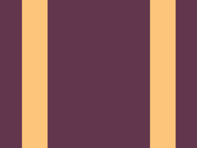

# Target #2 - Carrom

Battle: #1 - Pilot Battle

- CSSBattle target: https://cssbattle.dev/play/2
- Saved submission: https://cssbattle.dev/submission/to7sxnKFJkmy0lWqaptQ
- Submitted: 2022-02-02T16:05:06.445Z
- Score then: 788.39
- Score now: 788.39
- Score now collected: 2026-08-23T01:04:14.062Z
- Match: 100%
- Characters: 79
- Characters on current submit: 79

## Reference image


## Rendered output



## Solution

```html
<style>*{background:69%44q/65%53%conic-gradient(at 80%53q,#fdc57b 25%,#62374e 0
```

## Files

- `solution.html` - extracted HTML/CSS solution
- `reference.png` - official target image
- `rendered.png` - solution rendered in Chrome at 400x300
- `metadata.json` - target metadata and score details
