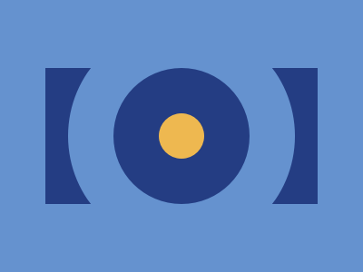
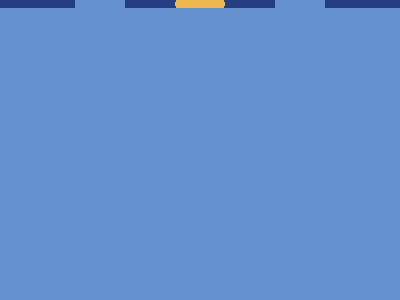

# Target #3 - Push Button

Battle: #1 - Pilot Battle

- CSSBattle target: https://cssbattle.dev/play/3
- Saved submission: https://cssbattle.dev/submission/PCJ2XWoH0U78hGEnfgOw
- Submitted: 2021-10-01T09:20:25.403Z
- Score then: 738.87
- Score now: 738.87
- Score now collected: 2026-08-23T01:04:14.062Z
- Match: 100%
- Characters: 111
- Characters on current submit: 111

## Reference image



## Rendered output



## Solution

```html
<style>*{margin:75 50;background:radial-gradient(1q,#EEB850 26q,0,#243D83 79q,0,#0000 132q,#243D83)space#6592CF
```

## Files

- `solution.html` - extracted HTML/CSS solution
- `reference.png` - official target image
- `rendered.png` - solution rendered in Chrome at 400x300
- `metadata.json` - target metadata and score details
