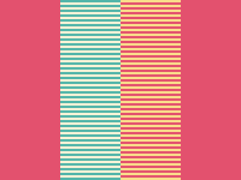

# Target #6 - Missing Slice

Battle: #1 - Pilot Battle

- CSSBattle target: https://cssbattle.dev/play/6
- Saved submission: https://cssbattle.dev/submission/yBpg6pkJhfwN9un8k2Cj
- Submitted: 2021-11-01T13:07:17.354Z
- Score then: 723.86
- Score now: 723.86
- Score now collected: 2026-08-23T01:04:14.062Z
- Match: 100%
- Characters: 123
- Characters on current submit: 123

## Reference image


## Rendered output



## Solution

```html
<style>*{background:radial-gradient(1q,#0000,25vw,#E3516E),conic-gradient(#FADE8B,25%,#E3516E 0 50%,#F7F3D7 0 75%,#51B5A9 0
```

## Files

- `solution.html` - extracted HTML/CSS solution
- `reference.png` - official target image
- `rendered.png` - solution rendered in Chrome at 400x300
- `metadata.json` - target metadata and score details
