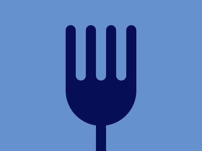

# Target #8 - Forking Crazy

Battle: #1 - Pilot Battle

- CSSBattle target: https://cssbattle.dev/play/8
- Saved submission: https://cssbattle.dev/submission/243k3yVVROu9c6aCC3Lm
- Submitted: 2022-01-06T09:45:16.197Z
- Score then: 669.92
- Score now: 575.82
- Score now collected: 2026-08-23T01:04:14.062Z
- Match: 100%
- Characters: 183
- Characters on current submit: 183

## Reference image



## Rendered output


## Solution

```html
<body bgcolor=6592CF style=margin:50+190+140;border-radius:1in;box-shadow:5vw+0,-5vw+0,10vw+0#6592CF,-10vw+0#6592CF,15vw+0,-15vw+0,0-201q+0+25vw#6592CF,0+32q+0+60px,0+2in text=060F55>
```

## Files

- `solution.html` - extracted HTML/CSS solution
- `reference.png` - official target image
- `rendered.png` - solution rendered in Chrome at 400x300
- `metadata.json` - target metadata and score details
