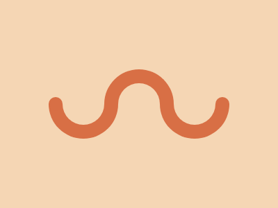
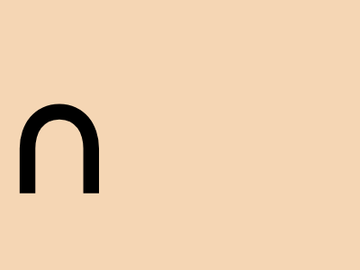

# Target #12 - Wiggly Moustache

Battle: #1 - Pilot Battle

- CSSBattle target: https://cssbattle.dev/play/12
- Saved submission: https://cssbattle.dev/submission/zwsBuKuOEqnMQvHvbDiO
- Submitted: 2021-11-11T21:51:15.531Z
- Score then: 684.60
- Score now: 684.60
- Score now collected: 2026-08-23T01:04:14.062Z
- Match: 100%
- Characters: 163
- Characters on current submit: 163

## Reference image



## Rendered output



## Solution

```html
ᐢ<p>ᐡ<p i>.<style>html{background:#F5D6B4;color:D86F45;font:300q a}*+*{-webkit-box-reflect:right -32vw;margin:48 136}p{margin:-280-80}[i]{margin:-417-76;font:40vw'
```

## Files

- `solution.html` - extracted HTML/CSS solution
- `reference.png` - official target image
- `rendered.png` - solution rendered in Chrome at 400x300
- `metadata.json` - target metadata and score details
