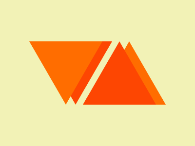
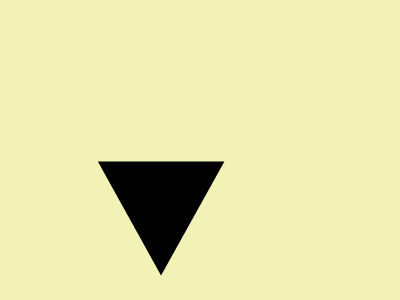

# Target #14 - Web Maker Logo

Battle: #2 - Visibility

- CSSBattle target: https://cssbattle.dev/play/14
- Saved submission: https://cssbattle.dev/submission/G52DPrZKoUeJ6tUWvwle
- Submitted: 2022-04-05T10:12:07.655Z
- Score then: 700.43
- Score now: 525.87
- Score now collected: 2026-08-23T01:04:14.062Z
- Match: 100%
- Characters: 145
- Characters on current submit: 145

## Reference image



## Rendered output



## Solution

```html
▾<p>▴<style>p{margin:-426 110;color:FD4602;--:#FF6D00}*{background:#F2F2B6;color:FF6D00;margin:-7.2%6;text-shadow:var(--,#FD4602)5vw 0;font:388q'
```

## Files

- `solution.html` - extracted HTML/CSS solution
- `reference.png` - official target image
- `rendered.png` - solution rendered in Chrome at 400x300
- `metadata.json` - target metadata and score details
