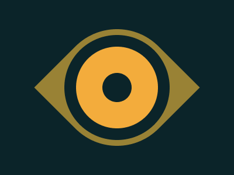

# Target #16 - Eye of the Tiger

Battle: #2 - Visibility

- CSSBattle target: https://cssbattle.dev/play/16
- Saved submission: https://cssbattle.dev/submission/ZADJFXtZy6AvbK0HbHcv
- Submitted: 2021-12-21T11:40:29.570Z
- Score then: 687.05
- Score now: 687.05
- Score now collected: 2026-08-23T01:04:14.062Z
- Match: 100%
- Characters: 160
- Characters on current submit: 160

## Reference image



## Rendered output


## Solution

```html
<style>*{margin:7%50;background:#0b2429}*>*{background:radial-gradient(1q,#0000 26q,#f3ac3c 0 74q,#0000 0 95q,#998235);border-radius:50%0;transform:rotate(45deg
```

## Files

- `solution.html` - extracted HTML/CSS solution
- `reference.png` - official target image
- `rendered.png` - solution rendered in Chrome at 400x300
- `metadata.json` - target metadata and score details
