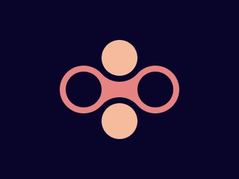

# Target #17 - Fidget Spinner

Battle: #2 - Visibility

- CSSBattle target: https://cssbattle.dev/play/17
- Saved submission: https://cssbattle.dev/submission/0inrTTz8I8b9D6olE7hm
- Submitted: 2021-10-05T12:01:41.940Z
- Score then: 649.61
- Score now: 649.61
- Score now collected: 2026-08-23T01:04:14.062Z
- Match: 100%
- Characters: 219
- Characters on current submit: 219

## Reference image



## Rendered output


## Solution

```html
<style>*>*{margin:120 230 120 110;border-radius:50%;color:09042A;box-shadow:63q 56q#F5BB9C,63q -56q#F5BB9C,63q 56q 0 11q,63q -56q 0 11q,inset 0 2in,30vw 0,0 0 0 11q#E78481,30vw 0 0 11q#E78481,63q 0 0 9q#E78481,0 0 0 9in
```

## Files

- `solution.html` - extracted HTML/CSS solution
- `reference.png` - official target image
- `rendered.png` - solution rendered in Chrome at 400x300
- `metadata.json` - target metadata and score details
