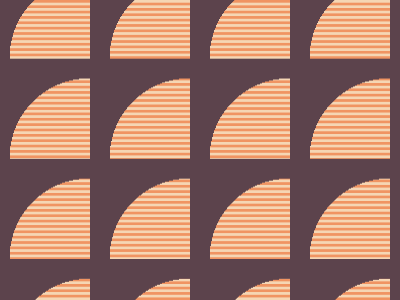

# Target #18 - Matrix

Battle: #2 - Visibility

- CSSBattle target: https://cssbattle.dev/play/18
- Saved submission: https://cssbattle.dev/submission/yPVRVdOz1vGG2APmJHqh
- Submitted: 2022-06-21T11:57:26.123Z
- Score then: 702.36
- Score now: 702.36
- Score now collected: 2026-08-23T01:04:14.062Z
- Match: 100%
- Characters: 143
- Characters on current submit: 143

## Reference image


## Rendered output



## Solution

```html
<style>*>*{background:radial-gradient(at 99%99%,#0000,84q,#5C434C 0)30%45%/25%106q,0 0/50%67%repeating-conic-gradient(#F5D6B4,25%,#F09462 0 50%
```

## Files

- `solution.html` - extracted HTML/CSS solution
- `reference.png` - official target image
- `rendered.png` - solution rendered in Chrome at 400x300
- `metadata.json` - target metadata and score details
