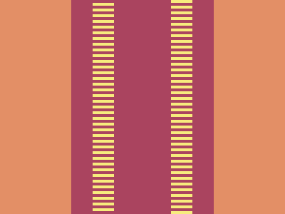

# Target #27 - Lock Up

Battle: #4 - Display

- CSSBattle target: https://cssbattle.dev/play/27
- Saved submission: https://cssbattle.dev/submission/MsUEo8tQbNXO39QdmZRg
- Submitted: 2021-10-25T18:31:04.053Z
- Score then: 708.39
- Score now: 708.39
- Score now collected: 2026-08-23T01:04:14.062Z
- Match: 100%
- Characters: 137
- Characters on current submit: 137

## Reference image


## Rendered output



## Solution

```html
<style>*{background:radial-gradient(1q,#AA445F 5ch,#0000 0 74q,#AA445F 0 25vw,#E38F66),repeating-conic-gradient(#F7EC7D,25%,#AA445F 0 50%
```

## Files

- `solution.html` - extracted HTML/CSS solution
- `reference.png` - official target image
- `rendered.png` - solution rendered in Chrome at 400x300
- `metadata.json` - target metadata and score details
