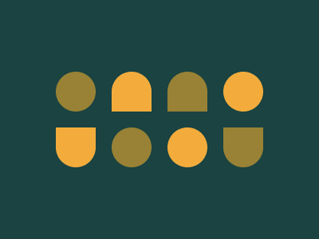

# Target #28 - Cups & Balls

Battle: #4 - Display

- CSSBattle target: https://cssbattle.dev/play/28
- Saved submission: https://cssbattle.dev/submission/y0LTIJ1mmSoONs76niZN
- Submitted: 2022-06-21T11:57:09.502Z
- Score then: 660.03
- Score now: 465.73
- Score now collected: 2026-08-23T01:04:14.062Z
- Match: 100%
- Characters: 199
- Characters on current submit: 199

## Reference image



## Rendered output


## Solution

```html
<a><a b c><a c><a b><a b d><a><a b><a d><style>a{--x:#EA39;float:left;margin:32 8-12 12;border-radius:50%50%3ch 3ch}[b]{--x:#F3AC3C}[c]{font:0%a}[d]{font:2in a}*{padding:25;background:var(--x,#1A443F
```

## Files

- `solution.html` - extracted HTML/CSS solution
- `reference.png` - official target image
- `rendered.png` - solution rendered in Chrome at 400x300
- `metadata.json` - target metadata and score details
