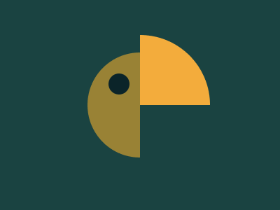

# Target #33 - Birdie

Battle: #7 - Backface

- CSSBattle target: https://cssbattle.dev/play/33
- Saved submission: https://cssbattle.dev/submission/4t3FZiQ9BNHPfvsAc6jx
- Submitted: 2021-11-04T08:49:53.333Z
- Score then: 670.59
- Score now: 1.20
- Score now collected: 2026-08-23T01:04:14.062Z
- Match: 100%
- Characters: 182
- Characters on current submit: 182

## Reference image



## Rendered output


## Solution

```html
<style>*>*{margin:75 200 75 125;border-radius:1in 0 0 1in;--:,#0B2429,5vh,#998235;--p:8q -32q}*{background:radial-gradient(1q var(--,at 0%100%,#F3AC3C,25vw,#1A4341))var(--p,50vw 50vh
```

## Files

- `solution.html` - extracted HTML/CSS solution
- `reference.png` - official target image
- `rendered.png` - solution rendered in Chrome at 400x300
- `metadata.json` - target metadata and score details
