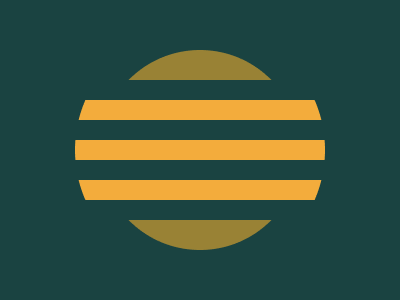

# Target #39 - Sunset

Battle: #7 - Backface

- CSSBattle target: https://cssbattle.dev/play/39
- Saved submission: https://cssbattle.dev/submission/HdLy2PRvvRHRae1MPePN
- Submitted: 2021-11-17T09:59:20.545Z
- Score then: 688.73
- Score now: 688.73
- Score now collected: 2026-08-23T01:04:14.062Z
- Match: 100%
- Characters: 158
- Characters on current submit: 158

## Reference image



## Rendered output


## Solution

```html
<style>*{background:radial-gradient(1q,#998235,25vw,#1A4341)}*>*{background:linear-gradient(#F3AC3C 50%,#1A4341 0)0 5vw/1%5ch;margin:80 0;clip-path:circle(42%
```

## Files

- `solution.html` - extracted HTML/CSS solution
- `reference.png` - official target image
- `rendered.png` - solution rendered in Chrome at 400x300
- `metadata.json` - target metadata and score details
