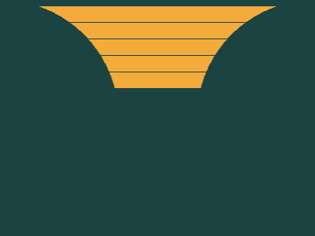

# Target #44 - Stripes

Battle: #8 - Transition

- CSSBattle target: https://cssbattle.dev/play/44
- Saved submission: https://cssbattle.dev/submission/xfcpmqYhbU8XA5ysLphY
- Submitted: 2021-11-22T17:35:04.485Z
- Score then: 726.24
- Score now: 726.24
- Score now collected: 2026-08-23T01:04:14.062Z
- Match: 100%
- Characters: 121
- Characters on current submit: 121

## Reference image


## Rendered output



## Solution

```html
<p>.<p>.<p>.<p>.<p>.<style>*{background:radial-gradient(1q,#1A4341,134em,#F3AC3C)fixed 212q}p{margin:60 0-40;font:7%/5vw'
```

## Files

- `solution.html` - extracted HTML/CSS solution
- `reference.png` - official target image
- `rendered.png` - solution rendered in Chrome at 400x300
- `metadata.json` - target metadata and score details
