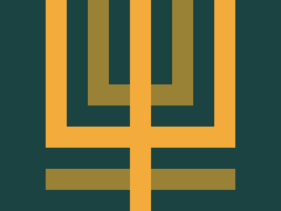

# Target #45 - Magical Tree

Battle: #9 - Margin

- CSSBattle target: https://cssbattle.dev/play/45
- Saved submission: https://cssbattle.dev/submission/ZGqRTW4aYtJPxCqre3Qd
- Submitted: 2021-10-26T19:55:58.940Z
- Score then: 678.39
- Score now: 678.39
- Score now collected: 2026-08-23T01:04:14.062Z
- Match: 100%
- Characters: 171
- Characters on current submit: 171

## Reference image



## Rendered output


## Solution

```html
<body bgcolor=F3AC3C text=1A434 style=margin:-78+185;box-shadow:0-3in+0+32q,0-3in+0+64q#998235,0-3in+0+95q,0-3in+0+30vw#F3AC3C,0-3in+0+50vh,0-76vh+0+30vw#998235,0+0+0+5in>
```

## Files

- `solution.html` - extracted HTML/CSS solution
- `reference.png` - official target image
- `rendered.png` - solution rendered in Chrome at 400x300
- `metadata.json` - target metadata and score details
