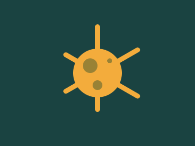

# Target #47 - Corona Virus

Battle: #10 - Block

- CSSBattle target: https://cssbattle.dev/play/47
- Saved submission: https://cssbattle.dev/submission/p493PzbaO2Wz2h0pyRVf
- Submitted: 2021-10-22T12:38:59.773Z
- Score then: 629.93
- Score now: 17.91
- Score now collected: 2026-08-23T01:04:14.062Z
- Match: 100%
- Characters: 272
- Characters on current submit: 272

## Reference image



## Rendered output


## Solution

```html
<b><c><d><style>*{background:var(--,#1A4341);position:fixed}*>*{width:10;height:180;--:#F3AC3C;border-radius:1in;margin:50 195}d{height:10;color:998235;margin:111 -40;box-shadow:6q -26q,65q -7vw 0 5q,36q 5q 0 10q,42q -16q 0 48q#F3AC3C}b,c{margin:5 9;transform:rotate(60deg
```

## Files

- `solution.html` - extracted HTML/CSS solution
- `reference.png` - official target image
- `rendered.png` - solution rendered in Chrome at 400x300
- `metadata.json` - target metadata and score details
