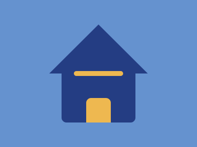

# Target #49 - Stay at Home

Battle: #10 - Block

- CSSBattle target: https://cssbattle.dev/play/49
- Saved submission: https://cssbattle.dev/submission/KSQVmDN5FN5nOCgRwM7s
- Submitted: 2021-10-07T06:49:04.080Z
- Score then: 636.57
- Score now: 0.94
- Score now collected: 2026-08-23T01:04:14.062Z
- Match: 100%
- Characters: 251
- Characters on current submit: 251

## Reference image



## Rendered output


## Solution

```html
<p i><p><p j><style>*{background:var(--,#6592cf)}p{position:fixed;inset:137q 159q;--:#eeb850;border-radius:11q}[i]{--:#243d83;inset:35q 132q}[j]{inset:195q 185q 0}body{margin:50 100 150;--:#243d83;clip-path:polygon(50%0,0%100%,0%200%,100%200%,100%100%
```

## Files

- `solution.html` - extracted HTML/CSS solution
- `reference.png` - official target image
- `rendered.png` - solution rendered in Chrome at 400x300
- `metadata.json` - target metadata and score details
