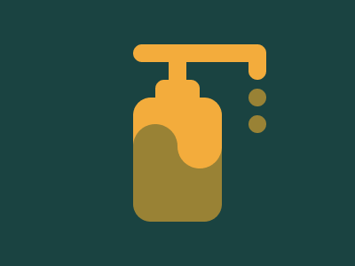

# Target #50 - Use Hand Sanitizer

Battle: #10 - Block

- CSSBattle target: https://cssbattle.dev/play/50
- Saved submission: https://cssbattle.dev/submission/CZc3naOXEx5FIBQEhqKv
- Submitted: 2021-10-07T14:44:46.220Z
- Score then: 610.20
- Score now: 483.37
- Score now collected: 2026-08-23T01:04:14.062Z
- Match: 100%
- Characters: 385
- Characters on current submit: 385

## Reference image



## Rendered output


## Solution

```html
<p><p i><p j><p l><p k><style>p{position:fixed;inset:var(--,36q 106q 226q 159q);--b:#f3ac3c}[i]{--:78q 185q 4cm;--r:10q}[j]{--:47q 201q 3cm}[l]{--:1cm 106q 205q 296q}[k]{--r:50%;color:998235;--:131q 159q 94px 212q;box-shadow:-53q 0,69q -58q 0 -16q,69q -26q 0 -16q}*{background:var(--b,#1a4341);border-radius:var(--r,21q)}body{margin:110 150 50;--b:linear-gradient(#f3ac3c 40%,#998235 0
```

## Files

- `solution.html` - extracted HTML/CSS solution
- `reference.png` - official target image
- `rendered.png` - solution rendered in Chrome at 400x300
- `metadata.json` - target metadata and score details
