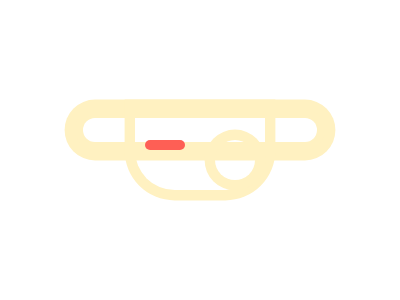

# Target #51 - Wear a Mask

Battle: #10 - Block

- CSSBattle target: https://cssbattle.dev/play/51
- Saved submission: https://cssbattle.dev/submission/hwcPoQLUgIbRRsQCeyb0
- Submitted: 2021-10-07T11:30:38.137Z
- Score then: 627.21
- Score now: 25.15
- Score now collected: 2026-08-23T01:04:14.062Z
- Match: 100%
- Characters: 282
- Characters on current submit: 282

## Reference image


## Rendered output



## Solution

```html
<a><b><c><d><style>*{background:var(--,#293462);position:fixed}*>*{border-radius:5vw;box-shadow:0 0 0 11q#FFF1C1;inset:116q 79q 50vh}b{--:#FFF1C1;inset:116q 143q;border-radius:0 0 42q 42q}c,d{--:#FE5F55;inset:30vw 228q 180q 153q}c{box-shadow:0 5vw#FE5F55}d{inset:148q 153q 30vw 228q
```

## Files

- `solution.html` - extracted HTML/CSS solution
- `reference.png` - official target image
- `rendered.png` - solution rendered in Chrome at 400x300
- `metadata.json` - target metadata and score details
