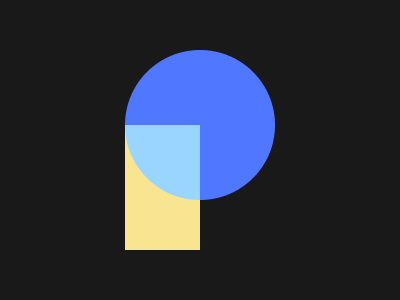

# Target #53 - Pastel Logo

Battle: #11 - Overflow

- CSSBattle target: https://cssbattle.dev/play/53
- Saved submission: https://cssbattle.dev/submission/6FBIYRwpEFJEBmDvvB9x
- Submitted: 2021-11-15T15:19:08.887Z
- Score then: 713.68
- Score now: 1.47
- Score now collected: 2026-08-23T01:04:14.062Z
- Match: 100%
- Characters: 132
- Characters on current submit: 132

## Reference image



## Rendered output


## Solution

```html
<style>*{background:radial-gradient(1q at var(--,50%132q,#25fc,75px,#19191A)0)}*>*{margin:125 50%50 125;--:100%0,#9ad5ff,79q,#f9e492
```

## Files

- `solution.html` - extracted HTML/CSS solution
- `reference.png` - official target image
- `rendered.png` - solution rendered in Chrome at 400x300
- `metadata.json` - target metadata and score details
