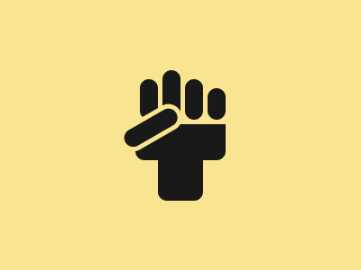

# Target #54 - Black Lives Matter

Battle: #11 - Overflow

- CSSBattle target: https://cssbattle.dev/play/54
- Saved submission: https://cssbattle.dev/submission/UeKKRyIRuxRfxoWPTvRi
- Submitted: 2021-08-03T15:06:19.292Z
- Score then: 611.99
- Score now: 375.35
- Score now collected: 2026-08-23T01:04:14.062Z
- Match: 100%
- Characters: 368
- Characters on current submit: 368

## Reference image



## Rendered output


## Solution

```html
<a><b><c><d><e><f><style>*{background:#F9E492;position:fixed}*>*{background:#191919;margin:var(--,69 75);height:var(--h,40)}a{width:100;border-radius:0 0 8pt 8pt}a *{width:50;--h:60;--:25;border-radius:8pt}b *{width:20;--h:45;--:-75-20}c{box-shadow:50px 0#191919}d{--h:55;--:-10 25}e{--h:35;--:20 50}f{--h:65;box-shadow:0 0 0 5px#F9E492;--:12-73;transform:rotate(60deg
```

## Files

- `solution.html` - extracted HTML/CSS solution
- `reference.png` - official target image
- `rendered.png` - solution rendered in Chrome at 400x300
- `metadata.json` - target metadata and score details
