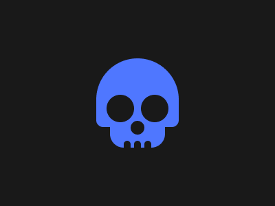

# Target #56 - Skull

Battle: #11 - Overflow

- CSSBattle target: https://cssbattle.dev/play/56
- Saved submission: https://cssbattle.dev/submission/flryUaLRQmFsbdwyTv1S
- Submitted: 2021-10-27T09:34:24.887Z
- Score then: 619.13
- Score now: 561.54
- Score now collected: 2026-08-23T01:04:14.062Z
- Match: 100%
- Characters: 319
- Characters on current submit: 319

## Reference image



## Rendered output


## Solution

```html
<a><b><c><d><style>*{background:#191919;position:fixed;color:191919;border-radius:var(--,84q 84q 1pc 1pc)}a,b{padding:50 60;background:#4F77FF;margin:77 132}b,d{margin:30-40;padding:25 40;--:5vw}c{padding:10;margin:-14-10;box-shadow:25px -7vw 0 10px,-25px -7vw 0 10px}d{padding:10 5;margin:19-20;box-shadow:5vh 0,30px 0
```

## Files

- `solution.html` - extracted HTML/CSS solution
- `reference.png` - official target image
- `rendered.png` - solution rendered in Chrome at 400x300
- `metadata.json` - target metadata and score details
