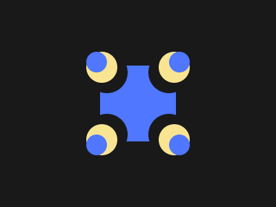

# Target #57 - Pillars

Battle: #11 - Overflow

- CSSBattle target: https://cssbattle.dev/play/57
- Saved submission: https://cssbattle.dev/submission/BJtCB276xp70R0Ql1XjO
- Submitted: 2021-11-05T23:01:12.272Z
- Score then: 646.85
- Score now: 447.67
- Score now collected: 2026-08-23T01:04:14.062Z
- Match: 100%
- Characters: 225
- Characters on current submit: 225

## Reference image



## Rendered output


## Solution

```html
<dl><p><style>*+*{margin:95 145}*>*{--b:#4F77FF;border-image:radial-gradient(var(--,#191919)71%,#0000 0)100%fill/var(--w,64q)/5vw}dl,p{height:100%;--b:#0000;--:#F9E492;--w:48q}p{--:#4F77FF;--w:32q}*{background:var(--b,#191919
```

## Files

- `solution.html` - extracted HTML/CSS solution
- `reference.png` - official target image
- `rendered.png` - solution rendered in Chrome at 400x300
- `metadata.json` - target metadata and score details
