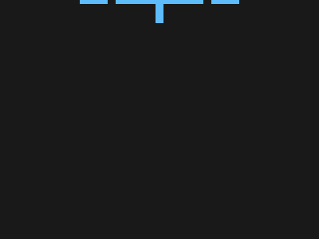

# Target #61 - ImprovMX

Battle: #12 - Blend

- CSSBattle target: https://cssbattle.dev/play/61
- Saved submission: https://cssbattle.dev/submission/PM9oEpSj4TxPpEeHJmJD
- Submitted: 2021-09-06T11:46:38.974Z
- Score then: 600.87
- Score now: 522.88
- Score now collected: 2026-08-23T01:04:14.062Z
- Match: 100%
- Characters: 643
- Characters on current submit: 643

## Reference image


## Rendered output



## Solution

```html
<p a><p b><p c><p d><p e><p f><p x><style>body{background:#191919;margin:0;display:flex;justify-content:center;align-items:center;--:10px solid#5DBCF9}p{position:absolute;border:var(--);border-bottom:none}[a]{width:30px;height:5vw;top:50}[b]{width:80px;height:50px;top:80}[c],[d]{width:80;height:30;top:130;border:none;border-top:var(--)}[c]{transform:rotate(-30deg);left:126;border-left:var(--)}[d]{right:126;transform:rotate(30deg);border-right:var(--)}[e],[f]{background:#5DBCF9;border:10px solid#191919}[e]{width:50vw;height:10px;top:178}[f]{width:110px;height:10px;top:198}[x]{width:10px;height:58px;top:120;background:#5DBCF9;border:none
```

## Files

- `solution.html` - extracted HTML/CSS solution
- `reference.png` - official target image
- `rendered.png` - solution rendered in Chrome at 400x300
- `metadata.json` - target metadata and score details
