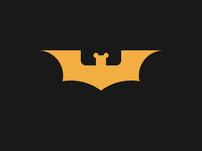
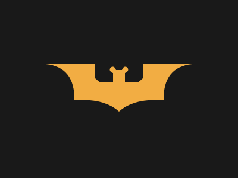

# Target #66 - Batmicky

Battle: #12 - Blend

- CSSBattle target: https://cssbattle.dev/play/66
- Saved submission: https://cssbattle.dev/submission/T9SCxL6zBXkprUeHBAdB
- Submitted: 2022-04-23T10:58:13.191Z
- Score then: 683.00
- Score now: 683.00
- Score now collected: 2026-08-23T01:04:14.062Z
- Match: 100%
- Characters: 165
- Characters on current submit: 165

## Reference image



## Rendered output



## Solution

```html
<p><p><style>*+*{background:#191919;transform:scalex(-1)}p{outline:solid 9in#F2AD43;clip-pat\68:path('m315 92q-49 5-48 61-50-4-75 19v-70h5c4-13 18 0 5 5v15h23l7-6V92
```

## Files

- `solution.html` - extracted HTML/CSS solution
- `reference.png` - official target image
- `rendered.png` - solution rendered in Chrome at 400x300
- `metadata.json` - target metadata and score details
