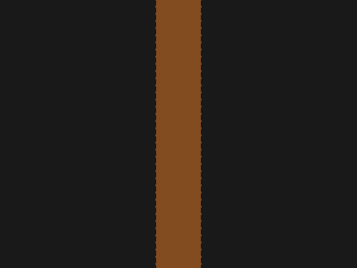

# Target #68 - Bell

Battle: #12 - Blend

- CSSBattle target: https://cssbattle.dev/play/68
- Saved submission: https://cssbattle.dev/submission/BCXuwvy8mVDzi4Db79JN
- Submitted: 2021-11-20T22:40:07.056Z
- Score then: 687.89
- Score now: 687.89
- Score now collected: 2026-08-23T01:04:14.062Z
- Match: 100%
- Characters: 159
- Characters on current submit: 159

## Reference image


## Rendered output



## Solution

```html
<style>*{background:radial-gradient(1q,#824B20,27q,#191919)0 63q}*>*{margin:90 140;background:#E08027;border-radius:50%50%11q 11q;box-shadow:0-62q 0-37q#F2AD43
```

## Files

- `solution.html` - extracted HTML/CSS solution
- `reference.png` - official target image
- `rendered.png` - solution rendered in Chrome at 400x300
- `metadata.json` - target metadata and score details
