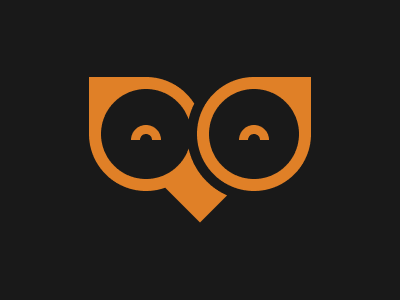
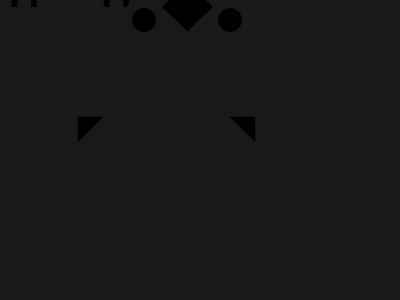

# Target #69 - PushOwl

Battle: #13 - Clip

- CSSBattle target: https://cssbattle.dev/play/69
- Saved submission: https://cssbattle.dev/submission/yDAT10DnQgZ3MsL9e28E
- Submitted: 2022-08-22T10:44:57.101Z
- Score then: 656.15
- Score now: 656.15
- Score now collected: 2026-08-23T01:04:14.062Z
- Match: 100%
- Characters: 206
- Characters on current submit: 206

## Reference image



## Rendered output



## Solution

```html
<b>ᐢ ⏠ᐢ◆<h5>　 ◤    ◥<style>img{padding:45;border:3vw solid;outline:solid 11q#191919;margin:-79-39 23;border-radius:50%}h5{margin:-109}body{margin:39%128;background:#191919;color:E08027;font:76q/0'
```

## Files

- `solution.html` - extracted HTML/CSS solution
- `reference.png` - official target image
- `rendered.png` - solution rendered in Chrome at 400x300
- `metadata.json` - target metadata and score details
