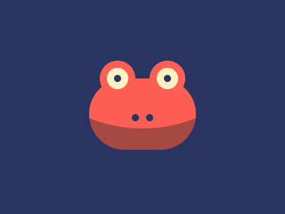

# Target #70 - Froggy

Battle: #13 - Clip

- CSSBattle target: https://cssbattle.dev/play/70
- Saved submission: https://cssbattle.dev/submission/uzxQ9tnE59DzYZ5u3WZz
- Submitted: 2021-10-25T14:49:40.388Z
- Score then: 627.21
- Score now: 2.43
- Score now collected: 2026-08-23T01:04:14.062Z
- Match: 100%
- Characters: 282
- Characters on current submit: 282

## Reference image



## Rendered output


## Solution

```html
<p><style>*>*{margin:110 125 90;--:at 50%-138q,#FE5F55 0 50vw,#A64942}p{position:fixed;--:,#293462 0 5q,#FFF1C1 0 16q,#FE5F55;padding:25;margin:-25 85;box-shadow:-26q 58q 0-21q#293462;-webkit-box-reflect:left 22q}*{border-radius:2in;background:radial-gradient(1q var(--,,#293462 0 0
```

## Files

- `solution.html` - extracted HTML/CSS solution
- `reference.png` - official target image
- `rendered.png` - solution rendered in Chrome at 400x300
- `metadata.json` - target metadata and score details
