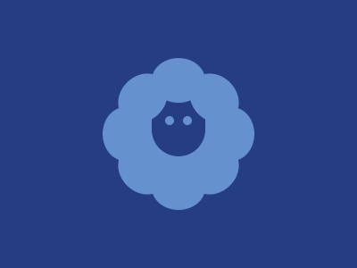

# Target #72 - Sheep

Battle: #13 - Clip

- CSSBattle target: https://cssbattle.dev/play/72
- Saved submission: https://cssbattle.dev/submission/W75RYXCtb6fMF0HMEbJg
- Submitted: 2021-10-25T14:19:28.099Z
- Score then: 614.65
- Score now: 194.42
- Score now collected: 2026-08-23T01:04:14.062Z
- Match: 100%
- Characters: 347
- Characters on current submit: 347

## Reference image



## Rendered output


## Solution

```html
<p><p o><b j><b><b i><b><b i><b><b i><b><style>*{background:#243D83;color:6592CF;position:fixed;margin:var(--,139 196)}[i]{--:-5 10}[j]{--:-50 30}p{border-radius:2in;padding:40 30;box-shadow:0 0 0 21q;--:-182-222}[o]{padding:5;--:-148-217;box-shadow:32q 0,11q 0}b{--:-11 12;background:#6592CF;border-radius:50%;padding:25 30;transform:rotate(45deg
```

## Files

- `solution.html` - extracted HTML/CSS solution
- `reference.png` - official target image
- `rendered.png` - solution rendered in Chrome at 400x300
- `metadata.json` - target metadata and score details
