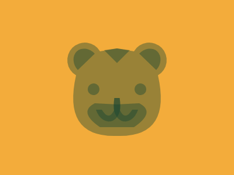

# Target #73 - Happy Tiger

Battle: #13 - Clip

- CSSBattle target: https://cssbattle.dev/play/73
- Saved submission: https://cssbattle.dev/submission/4pJsWsb69W3tfgbMTLM0
- Submitted: 2022-08-22T10:45:12.935Z
- Score then: 618.94
- Score now: 618.94
- Score now collected: 2026-08-23T01:04:14.062Z
- Match: 100%
- Characters: 320
- Characters on current submit: 320

## Reference image


## Rendered output



## Solution

```html
<p><p><p><dl><p><p><p><style>*{background:#F3AC3B;scale:-1 1}p+p{color:FFF;--p:'M192 163v39h29q38-26 9-41'}p+p+p{color:1A4341;--p:'m214,70-22-3v25m5,81q9,19,21-1h10a5,7,8,01-40-20h9m27-9a10,10,0,112,2m4-69a5,6,40,1129,28'}p{color:#1436;outline:9in solid;clip-path:pat\68(var(--p,'M192 67v150q94 3 70-104a30 30 0 10-41-41
```

## Files

- `solution.html` - extracted HTML/CSS solution
- `reference.png` - official target image
- `rendered.png` - solution rendered in Chrome at 400x300
- `metadata.json` - target metadata and score details
