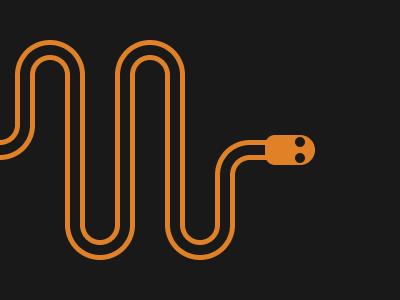

# Target #74 - Danger Noodle

Battle: #13 - Clip

- CSSBattle target: https://cssbattle.dev/play/74
- Saved submission: https://cssbattle.dev/submission/oAjQm9AZAC2PFPXyFEpr
- Submitted: 2021-09-07T09:53:32.883Z
- Score then: 600.51
- Score now: 25.79
- Score now collected: 2026-08-23T01:04:14.062Z
- Match: 100%
- Characters: 699
- Characters on current submit: 699

## Reference image



## Rendered output


## Solution

```html
<a><style>*{--:radial-gradient(1q at 60px 100%,var(--c))no-repeat;--b:radial-gradient(1q at 50%0%,var(--c))no-repeat;--c:#191919 15px,#E08027 0 20px,#191919 0 30px,#E08027 0 35px,#191919 0 65px;background:var(--)-10px -21px/100px 1in,var(--)90px -21px/100px 1in,var(--b)50px 225px/100px 9in,var(--b)150px 225px/100px 9in,var(--b)-50px 125px/100px 9in,var(--)190px -17px/60px 2in,repeating-linear-gradient(90deg,var(--c))no-repeat 0 75px/250px 200px,#191919}*>*{background:#E08027;margin:135 85 135 265;border-radius:60px 1in 1in 60px;box-shadow:-27px 0 0-10px#191919,-21px 0 0-5px#E08027}a{position:fixed;border-radius:1in;width:10;height:10;top:2;left:30;background:#191919;box-shadow:0 16px#191919
```

## Files

- `solution.html` - extracted HTML/CSS solution
- `reference.png` - official target image
- `rendered.png` - solution rendered in Chrome at 400x300
- `metadata.json` - target metadata and score details
