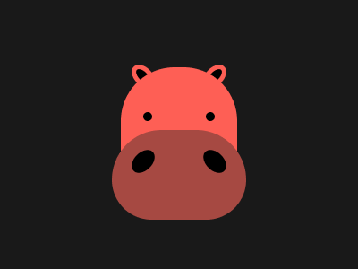

# Target #75 - Hippo

Battle: #13 - Clip

- CSSBattle target: https://cssbattle.dev/play/75
- Saved submission: https://cssbattle.dev/submission/gIxYBUHkNLzURrY99RmD
- Submitted: 2021-08-03T14:47:49.762Z
- Score then: 600.11
- Score now: 600.11
- Score now collected: 2026-08-23T01:04:14.062Z
- Match: 100%
- Characters: 861
- Characters on current submit: 861

## Reference image



## Rendered output


## Solution

```html
 <div c><div b><i><u></u></i></div></div><style>body{background-color:#171d23;display:flex;flex-direction:column;align-items:center;justify-content:center;height:100vh;overflow:hidden;margin:0;}[c]{background-color:white;width:400;height:300;position:relative;}[b]{margin:0;top:0;left:0;right:0;bottom:0;position:absolute;}[c] *{position:absolute;background:var(--b, #191919);padding:var(--p, 0);margin:var(--m);border-radius:var(--r, 0);}[c] i{--b:#fe5f55;--p:65;--r:60px 60px 0 0;--m:75 135}[c] u{--b:#a64942;--p:50 75;--m:5 -75;--r:55px 55px 45px 45px;}[c] img{transform:rotate(var(--t, 45deg));--b:#000;--p:5px 10px;border:5px solid #fe5f55;--r:50%;--m:75 145}[c] img + img{--t:135deg;--m:75 225;}[c] i img{--p:5;--m:-15 -40;border:0;}[c] i * + img{--m:-15 30;}[c] u img{--p:15 10;--m:-30 -50}[c] u * + img{--m:-30px 30px
```

## Files

- `solution.html` - extracted HTML/CSS solution
- `reference.png` - official target image
- `rendered.png` - solution rendered in Chrome at 400x300
- `metadata.json` - target metadata and score details
