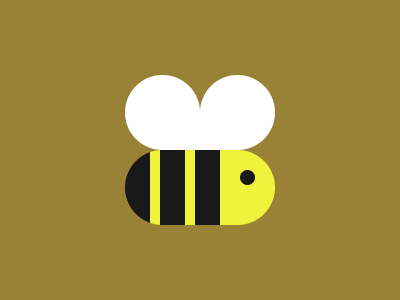

# Target #76 - Beeee

Battle: #13 - Clip

- CSSBattle target: https://cssbattle.dev/play/76
- Saved submission: https://cssbattle.dev/submission/Cubz1rLFvGr4bYCXrfTa
- Submitted: 2021-11-10T15:48:15.276Z
- Score then: 629.65
- Score now: 21.40
- Score now collected: 2026-08-23T01:04:14.062Z
- Match: 100%
- Characters: 273
- Characters on current submit: 273

## Reference image



## Rendered output


## Solution

```html
<p><style>*>*{border-radius:1in;margin:150 125 75;color:FFF;--:repeating-linear-gradient(90deg,#191919,26q,#0000 0 37q)space 0/1in#EFF33C;box-shadow:0-63q 0-16q}p{position:fixed;padding:8q;margin:20 115;box-shadow:-90q -69q 0 32q,-11q -69q 0 32q}*{background:var(--,#998235
```

## Files

- `solution.html` - extracted HTML/CSS solution
- `reference.png` - official target image
- `rendered.png` - solution rendered in Chrome at 400x300
- `metadata.json` - target metadata and score details
