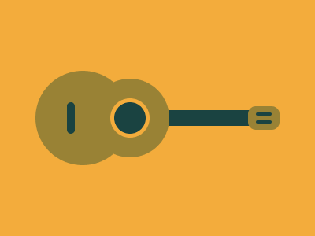

# Target #78 - Ukulele

Battle: #14 - ZIndex

- CSSBattle target: https://cssbattle.dev/play/78
- Saved submission: https://cssbattle.dev/submission/b8UUKUoFHN0XYruonHO7
- Submitted: 2021-12-02T09:03:18.144Z
- Score then: 614.93
- Score now: 279.35
- Score now collected: 2026-08-23T01:04:14.062Z
- Match: 100%
- Characters: 345
- Characters on current submit: 345

## Reference image



## Rendered output


## Solution

```html
<b><c><e><d><style>*{background:var(--b,#F3AC3C)}b{color:998235;box-shadow:0 0 0 5px#F3AC3C,0 0 0 30px,-63q 0 0 5ch;--:138q 228q 138q 153q}c{--:138q 323q 138q 90q}d{--:151q 58q 162q 344q;box-shadow:0 10px#1A4341}e{--b:#998235;--:143q 48q 143q 333q;--r:3vh}*>*{position:fixed;--b:#1A4341;border-radius:var(--r,1in);inset:var(--,140q 70q 140q 100q
```

## Files

- `solution.html` - extracted HTML/CSS solution
- `reference.png` - official target image
- `rendered.png` - solution rendered in Chrome at 400x300
- `metadata.json` - target metadata and score details
