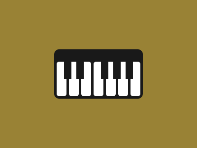

# Target #80 - Piano

Battle: #14 - ZIndex

- CSSBattle target: https://cssbattle.dev/play/80
- Saved submission: https://cssbattle.dev/submission/FV97Sqi6tbpQJ4c1eXeu
- Submitted: 2021-10-26T22:26:52.243Z
- Score then: 626.45
- Score now: 17.66
- Score now collected: 2026-08-23T01:04:14.062Z
- Match: 100%
- Characters: 285
- Characters on current submit: 285

## Reference image



## Rendered output


## Solution

```html
<a><k><c><c><c><c><c><c><c><s><r><r><r i><r><r><r><style>*{background:var(--,#998235);position:fixed}a,r{--:#191919}r{width:15;height:35;margin:0 25}a{inset:106q 116q;border-radius:11q}c{width:20;height:70;--:#FFF;margin:0 25;border-radius:5q}s{margin:0-160}[i]{--:#0000}k{margin:25-20
```

## Files

- `solution.html` - extracted HTML/CSS solution
- `reference.png` - official target image
- `rendered.png` - solution rendered in Chrome at 400x300
- `metadata.json` - target metadata and score details
