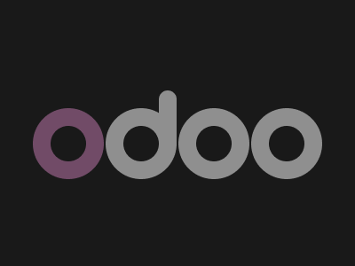

# Target #81 - Odoo

Battle: #15 - Filter

- CSSBattle target: https://cssbattle.dev/play/81
- Saved submission: https://cssbattle.dev/submission/vJrbCEOmRSAExqunzfeb
- Submitted: 2021-10-19T22:41:44.798Z
- Score then: 656.69
- Score now: 351.67
- Score now collected: 2026-08-23T01:04:14.062Z
- Match: 100%
- Characters: 205
- Characters on current submit: 205

## Reference image



## Rendered output


## Solution

```html
<a j><a><a><a><a i><style>body{margin:121 36;background:#191919}[j]{--:#714B67}[i]{padding:40 10;margin:-101 143}a{float:left;padding:40;margin:1;border-radius:1in;box-shadow:inset 0 0 0 21q var(--,#8F8F8F
```

## Files

- `solution.html` - extracted HTML/CSS solution
- `reference.png` - official target image
- `rendered.png` - solution rendered in Chrome at 400x300
- `metadata.json` - target metadata and score details
