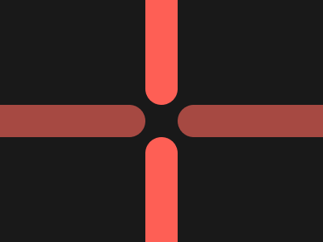

# Target #84 - Junction

Battle: #15 - Filter

- CSSBattle target: https://cssbattle.dev/play/84
- Saved submission: https://cssbattle.dev/submission/bs61qTW3XNNRruKgEEY8
- Submitted: 2021-12-09T09:37:22.128Z
- Score then: 742.90
- Score now: 742.90
- Score now collected: 2026-08-23T01:04:14.062Z
- Match: 100%
- Characters: 108
- Characters on current submit: 108

## Reference image



## Rendered output


## Solution

```html
<body bgcolor=191919 text=A64A4><p> ⍑  ⍊</p>⏤ ⏤<style>*{margin:-110-66-541;font:700 513q/74%a}p{color:FE5F55
```

## Files

- `solution.html` - extracted HTML/CSS solution
- `reference.png` - official target image
- `rendered.png` - solution rendered in Chrome at 400x300
- `metadata.json` - target metadata and score details
