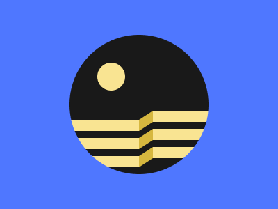

# Target #93 - Great Wall

Battle: #16 - Aspect

- CSSBattle target: https://cssbattle.dev/play/93
- Saved submission: https://cssbattle.dev/submission/OZX3j1vhMie6QFafyPpM
- Submitted: 2021-11-15T22:51:30.509Z
- Score then: 621.65
- Score now: 2.17
- Score now collected: 2026-08-23T01:04:14.062Z
- Match: 100%
- Characters: 306
- Characters on current submit: 306

## Reference image



## Rendered output


## Solution

```html
<p><p i><p j><style>*{background:var(--,#4F77FF)}*>*{--:radial-gradient(1q,#F9E492,5vw,#191919)-5ch -5ch;clip-path:circle(25vw)}[i]{margin:151 210}[j]{transform:matrix(.2,-.13,0,1,60,-7);--c:#D6B73F}p{position:fixed;padding:35 50;margin:164 92;--:repeating-linear-gradient(var(--c,#F9E492),1em,#0000 0 26px
```

## Files

- `solution.html` - extracted HTML/CSS solution
- `reference.png` - official target image
- `rendered.png` - solution rendered in Chrome at 400x300
- `metadata.json` - target metadata and score details
