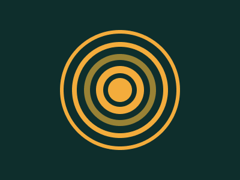
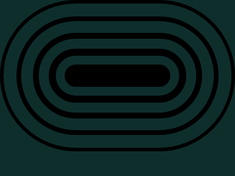

# Target #94 - Ripples

Battle: #16 - Aspect

- CSSBattle target: https://cssbattle.dev/play/94
- Saved submission: https://cssbattle.dev/submission/yw1RsQlGo3pPXXtqAdtx
- Submitted: 2021-12-03T22:25:40.660Z
- Score then: 688.73
- Score now: 597.88
- Score now collected: 2026-08-23T01:04:14.062Z
- Match: 100%
- Characters: 158
- Characters on current submit: 158

## Reference image



## Rendered output



## Solution

```html
<dt><dl><slot><p><style>*{background:#0E2E2C;border-radius:5in;color:F3AC3C;border:solid.4em;margin:50 100}dt{color:998235}* *{font:125%a;margin:max(4.3% + 6q
```

## Files

- `solution.html` - extracted HTML/CSS solution
- `reference.png` - official target image
- `rendered.png` - solution rendered in Chrome at 400x300
- `metadata.json` - target metadata and score details
