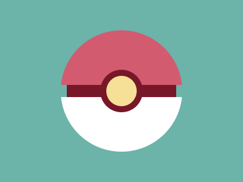

# Target #95 - Pokeball

Battle: #16 - Aspect

- CSSBattle target: https://cssbattle.dev/play/95
- Saved submission: https://cssbattle.dev/submission/gYTMeINMxipyLtsaRs9B
- Submitted: 2021-11-20T21:56:01.804Z
- Score then: 687.89
- Score now: 27.68
- Score now collected: 2026-08-23T01:04:14.062Z
- Match: 100%
- Characters: 159
- Characters on current submit: 159

## Reference image



## Rendered output


## Solution

```html
<p>.<style>*{background:radial-gradient(1q,#F6DF96 26q,#781728 0 37q,var(--,#D25B70)0 12.5ch,#6CB3A9)fixed}*>*{margin:35%0 0;--:#FFF}p{--:#781728;font:90%/5vw'
```

## Files

- `solution.html` - extracted HTML/CSS solution
- `reference.png` - official target image
- `rendered.png` - solution rendered in Chrome at 400x300
- `metadata.json` - target metadata and score details
