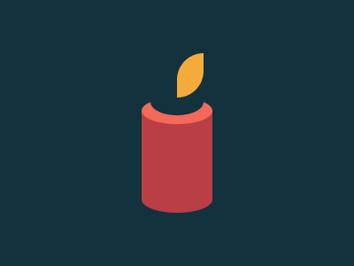

# Target #98 - Candle

Battle: #17 - Christmas 🎄

- CSSBattle target: https://cssbattle.dev/play/98
- Saved submission: https://cssbattle.dev/submission/dwyToDC2jQjCqsqK1JpZ
- Submitted: 2021-12-25T22:17:31.051Z
- Score then: 660.03
- Score now: 437.72
- Score now collected: 2026-08-23T01:04:14.062Z
- Match: 100%
- Characters: 199
- Characters on current submit: 199

## Reference image



## Rendered output


## Solution

```html
<style>*{background:#14313E;margin:110 40%60;color:F3695A;box-shadow:0-25vw var(--,#7137)inset,9q -82pt inset,-9q -82pt inset;border-radius:40q var(--r,/16q)}*+*{margin:-50 10 130 40;--r:0;--:#F3AC3C
```

## Files

- `solution.html` - extracted HTML/CSS solution
- `reference.png` - official target image
- `rendered.png` - solution rendered in Chrome at 400x300
- `metadata.json` - target metadata and score details
