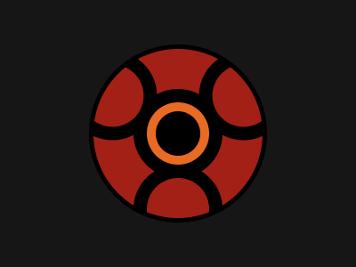

# Target #101 - Sharingan

Battle: #18 - Float

- CSSBattle target: https://cssbattle.dev/play/101
- Saved submission: https://cssbattle.dev/submission/FTG9GCMLczhNRrcPZrVB
- Submitted: 2022-03-24T15:12:50.666Z
- Score then: 662.36
- Score now: 5.19
- Score now collected: 2026-08-23T01:04:14.062Z
- Match: 100%
- Characters: 195
- Characters on current submit: 195

## Reference image



## Rendered output


## Solution

```html
<style>*{background:radial-gradient(1q,#000 25px,#E96A23 0 37q,#0000 0 95px,#000 0 25vw,#161616),var(--),var(--)46q -45q/37vw,var(--)0 90q#A22015;--:radial-gradient(1q,#0000 37q,#000 0 53q,#0000)
```

## Files

- `solution.html` - extracted HTML/CSS solution
- `reference.png` - official target image
- `rendered.png` - solution rendered in Chrome at 400x300
- `metadata.json` - target metadata and score details
