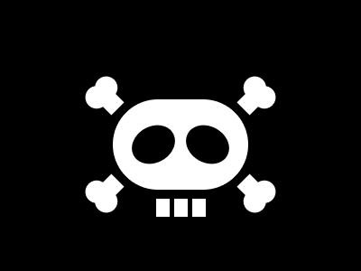

# Target #102 - One Piece

Battle: #18 - Float

- CSSBattle target: https://cssbattle.dev/play/102
- Saved submission: https://cssbattle.dev/submission/aWPQetakE5gJxBLCtDPD
- Submitted: 2022-04-04T15:54:02.650Z
- Score then: 606.09
- Score now: 606.09
- Score now collected: 2026-08-23T01:04:14.062Z
- Match: 100%
- Characters: 439
- Characters on current submit: 439

## Reference image



## Rendered output


## Solution

```html
<p i><p j><p j k><div><p j l><style>*,p{background:#000}*>*,[j]{background:#fff}body{-webkit-box-reflect:left;margin:110 125 90 200;padding:30 5;border-radius:0 1in 1in 0}[i]{height:40;width:50;margin:0;border-radius:50%;transform:rotate(30deg)}[j]{position:fixed;height:20;width:15;margin:40 -12}[k]{margin:40 8}div{-webkit-box-reflect:above 5ch}[l]{margin:0 55;padding:20;clip-pat\68:path('m17 12 9 9c27-6 22 23 9 24-5 19-33 11-24-9l-9-9
```

## Files

- `solution.html` - extracted HTML/CSS solution
- `reference.png` - official target image
- `rendered.png` - solution rendered in Chrome at 400x300
- `metadata.json` - target metadata and score details
