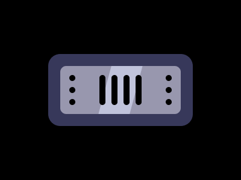

# Target #104 - Amegakure

Battle: #18 - Float

- CSSBattle target: https://cssbattle.dev/play/104
- Saved submission: https://cssbattle.dev/submission/hOPKXgsqruyYtv2I4tF9
- Submitted: 2022-03-31T14:39:08.168Z
- Score then: 613.31
- Score now: 613.31
- Score now collected: 2026-08-23T01:04:14.062Z
- Match: 100%
- Characters: 357
- Characters on current submit: 357

## Reference image



## Rendered output


## Solution

```html
<div><p><p j><style>html{background:#37385A;margin:90 80;box-shadow:0 0 0 9in#000;border-radius:5vw}p{height:10;width:10;color:0;box-shadow:16q 5vh,16q 37q,16q 58q}[j]{height:50;margin:3;box-shadow:66q -12q,87q -12q}div{-webkit-box-reflect:left -50vw}*>*{border-radius:11q}*+*{margin:20;background:linear-gradient(105deg,#9897AE 87q,#C0C3DB 0 44vh,#9897AE 0
```

## Files

- `solution.html` - extracted HTML/CSS solution
- `reference.png` - official target image
- `rendered.png` - solution rendered in Chrome at 400x300
- `metadata.json` - target metadata and score details
