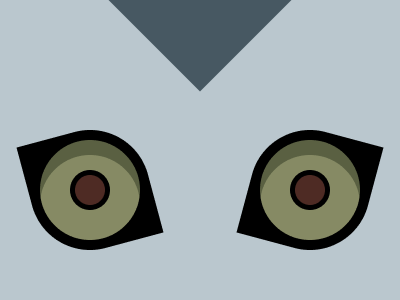
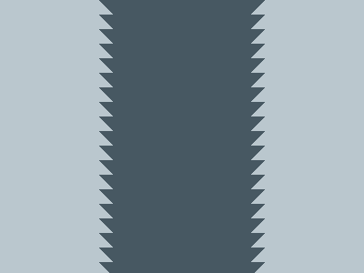

# Target #105 - Ryuk

Battle: #18 - Float

- CSSBattle target: https://cssbattle.dev/play/105
- Saved submission: https://cssbattle.dev/submission/Z6QJpRZKicRUH17u8tQT
- Submitted: 2022-03-31T14:13:15.433Z
- Score then: 620.84
- Score now: 620.84
- Score now collected: 2026-08-23T01:04:14.062Z
- Match: 100%
- Characters: 310
- Characters on current submit: 310

## Reference image



## Rendered output



## Solution

```html
<p><style>*+*{background:conic-gradient(from 45deg at 50%97q,#BAC7CE 75%,#475862 0);-webkit-box-reflect:right -4in}p{padding:60;margin:130 242;transform:rotate(15deg);border-radius:50%0;background:radial-gradient(#4E2B24 5vh,#000 0 5vw,#0000 0 53q,#000 0),radial-gradient(6in at 4em 74px,#868A64 50px,#5A6042 0
```

## Files

- `solution.html` - extracted HTML/CSS solution
- `reference.png` - official target image
- `rendered.png` - solution rendered in Chrome at 400x300
- `metadata.json` - target metadata and score details
