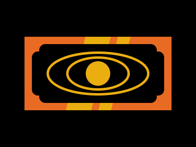

# Target #108 - Clow Card

Battle: #18 - Float

- CSSBattle target: https://cssbattle.dev/play/108
- Saved submission: https://cssbattle.dev/submission/52OaVW2O1gkegt9BOue0
- Submitted: 2022-04-04T13:10:13.900Z
- Score then: 613.57
- Score now: 12.90
- Score now collected: 2026-08-23T01:04:14.062Z
- Match: 100%
- Characters: 355
- Characters on current submit: 355

## Reference image



## Rendered output


## Solution

```html
<s><l><o><n><t><style>*{background:var(--,#000)}*>*{inset:71q 44q;--:linear-gradient(105deg,#E96A23 30vw,#EBAE11 0 180q,#E96A23 0 23ch,#EBAE11 0 222q,#E96A23 0);position:fixed}s,l,o,n,t{--:#000;inset:95q 5em;border-radius:3vw}l{inset:35vh 69q}o,n,t{border:solid 6q#EBAE11;border-radius:50%}o{inset:35vh 95px}n{inset:115px 45vh}t{inset:132q 185q;--:#EBAE11
```

## Files

- `solution.html` - extracted HTML/CSS solution
- `reference.png` - official target image
- `rendered.png` - solution rendered in Chrome at 400x300
- `metadata.json` - target metadata and score details
