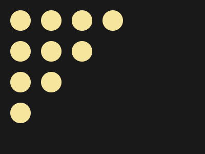
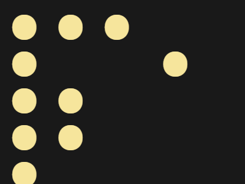

# Target #109 - Curtain

Battle: #19 - Spacing

- CSSBattle target: https://cssbattle.dev/play/109
- Saved submission: https://cssbattle.dev/submission/xgXnvrC17KybEaB6QWVU
- Submitted: 2022-07-04T10:18:46.514Z
- Score then: 771.26
- Score now: 771.26
- Score now collected: 2026-08-23T01:04:14.062Z
- Match: 100%
- Characters: 89
- Characters on current submit: 89

## Reference image



## Rendered output



## Solution

```html
⦁ ⦁ ⦁ ⦁  ⦁ ⦁ ⦁  ⦁ ⦁   ⦁<body bgcolor=191919 text=F6E59C style=margin:9+10;font:916%/.41'>
```

## Files

- `solution.html` - extracted HTML/CSS solution
- `reference.png` - official target image
- `rendered.png` - solution rendered in Chrome at 400x300
- `metadata.json` - target metadata and score details
