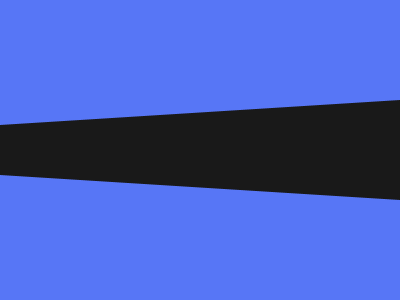

# Target #113 - Black Light

Battle: #19 - Spacing

- CSSBattle target: https://cssbattle.dev/play/113
- Saved submission: https://cssbattle.dev/submission/OxOZ72VI7tsSLBI5bhXb
- Submitted: 2022-07-05T07:30:04.249Z
- Score then: 790.19
- Score now: 790.19
- Score now collected: 2026-08-23T01:04:14.062Z
- Match: 100%
- Characters: 78
- Characters on current submit: 78

## Reference image



## Rendered output


## Solution

```html
<style>*{background:conic-gradient(from 86.4deg at -25em,#191919,2%,#5776F6 0
```

## Files

- `solution.html` - extracted HTML/CSS solution
- `reference.png` - official target image
- `rendered.png` - solution rendered in Chrome at 400x300
- `metadata.json` - target metadata and score details
