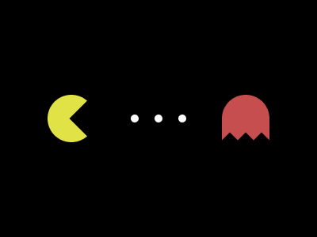
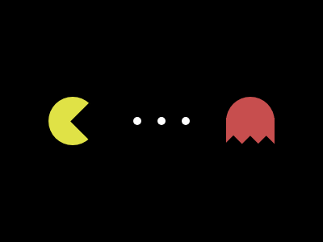

# Target #119 - Pacman

Battle: #20 - Hover

- CSSBattle target: https://cssbattle.dev/play/119
- Saved submission: https://cssbattle.dev/submission/jd04xWeeYf9PG9406m6k
- Submitted: 2022-08-30T11:32:00.631Z
- Score then: 602.04
- Score now: 602.04
- Score now collected: 2026-08-23T01:04:14.062Z
- Match: 100%
- Characters: 554
- Characters on current submit: 554

## Reference image



## Rendered output



## Solution

```html
<p a></p><p b></p><style>body{background:#000}
    [a]{background:#E0E246;border-radius:50%;width:60px;aspect-ratio:1;position:absolute;left:60px;top:104px;box-shadow:80px 0 0 -25px #fff,110px 0 0 -25px #fff,140px 0 0 -25px #fff,220px 0 0 0 #C74E4E;}[a]::before{background:#000;width:33px;aspect-ratio:1;transform:rotate(45deg);position:absolute;left:34px;top:13.5px;content:'';box-shadow:170px -112px 0 0 #000,155px -97.5px 0 0 #000,184px -126px 0 0 #000;}[b]{background:#C74E4E;width:60px;height:33px;position:absolute;left:280px;top:130px;z-index:-1;}
```

## Files

- `solution.html` - extracted HTML/CSS solution
- `reference.png` - official target image
- `rendered.png` - solution rendered in Chrome at 400x300
- `metadata.json` - target metadata and score details
